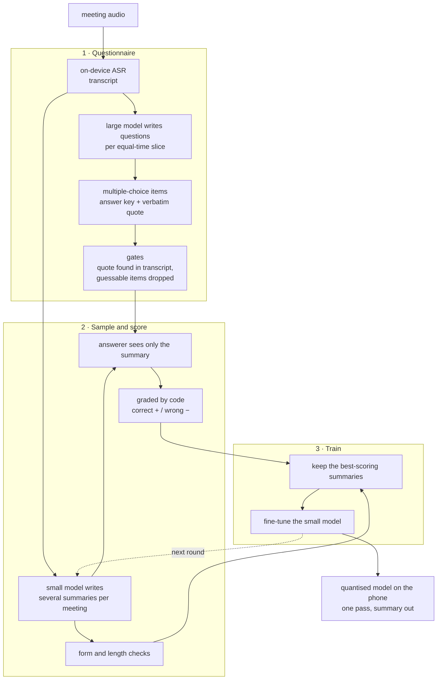

# Meeting Summarizer v4

Reliable minutes for long meetings, produced **on the phone**.

The input is a 1.5–3 h zh-TW meeting transcribed by on-device ASR. The output is a structured summary in which statements cite the transcript time they rest on.

**Status, 2026-11-11: planned. The questionnaire and its scorer exist and are being validated; no v4 training has run yet.**

One small model on the phone (Spark-X2.6 1.7B, Q4) reads the whole transcript once and writes the summary directly. The target is 2–3 h zh-TW meetings mixed with English, within about 3 GB of memory. The target device is the **Samsung Galaxy A53**; memory and speed still have to be measured on it. The bar to beat is the agentic Gemma-4-E4B fine-tune (mobile-v2).

**Idea.** A good summary is good in form and in content.

- *Form* (sections, length, timestamps) is enforced by a grammar and checked by code.
- *Content* is measured by a questionnaire: a reader who holds only the summary should answer questions that cover the whole meeting.

**Questionnaire.** The transcript is cut into equal-time slices so the end of the meeting weighs as much as the start. Each item has four options plus "not in the summary"; wrong options are other numbers, people or outcomes from the same meeting, so a wrong binding is caught. Items answerable without any text are dropped. Grading is a letter comparison, with no grader model.

**Training.** First offline: sample several summaries per meeting, score them, and train on the best ones (or on best/worst pairs). Online GRPO with the questionnaire score as reward comes only if the offline round shows a signal. The per-sentence contradiction judge (see Evaluation) stays, because a questionnaire does not penalise filler or unsupported sentences.

**Before any training:** the score must separate a known better system from a weaker one at equal length, and differences between samples must exceed its repeat noise.

## Layout

| path | contents |
|---|---|
| `eval/onepass_summary.py` | one-pass summary with the form grammar |
| `eval/qa_build.py`, `eval/qa_mcq.py` | questionnaire builder; multiple-choice conversion |
| `eval/qa_score.py`, `eval/qa_score_mcq.py` | open-answer and multiple-choice scoring |
| `eval/judge_prose_tx.py`, `eval/judge_prose.py` | contradiction judge; coverage judge |
| `scripts/qa_metric.sh`, `scripts/qa_spread.sh`, `scripts/qa_mcq.sh` | validation runs of the questionnaire score |

## Evaluation

Every round is read on three held-out sets (financial talks, legislative sessions, multi-speaker meetings) with several seeds:

- **Contradicted rate** (`eval/judge_prose_tx.py`): each sentence is checked against the transcript around its timestamp and labelled supported, contradicted or unsupported.
- **Coverage** (`eval/judge_prose.py --units`): share of reference points the summary carries.
- **Questionnaire score** (v4): correct, wrong and abstained answers, by third of the meeting and per 1000 characters.

ASR output is never corrected; long meetings are never excluded.

## Released model and earlier work

The model currently released is **mobile-v2**, a reading agent with an external journal on Gemma-4-E2B/E4B. Its model card, app integration and results are in [docs/mobile-v2.md](docs/mobile-v2.md); older versions are in [docs/version-history.md](docs/version-history.md).

The agent is reliable but slow on a phone. v4 replaces it with one pass of a smaller model and moves the effort into the training signal. Nothing from v4 is released yet.

## Status

Research, not production. Still to do: validate the questionnaire score, run the first offline round, human evaluation, and measurement on the Galaxy A53 (memory, speed, heat).
