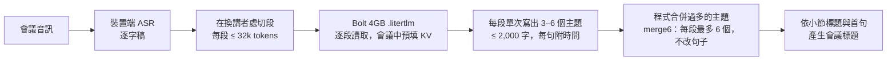

# Meeting Summarizer

在手機上即時產生長會議的可靠摘要：會議進行中由裝置端 ASR 轉寫，小模型逐段讀取，會後輸出分段摘要。目標是 1.5–3 小時、以台灣華語為主並夾雜英文的會議。摘要裡每一句都標註它所依據的逐字稿時間。

**狀態（2026-11-28）：研究階段，v6 目標尚未達成。** 要發佈的是手機 app 引擎用的 `.litertlm`。v5 通過的凍結測試用的是 llama.cpp 的 Q4_K_M 檔（見 [docs/v5-results.md](docs/v5-results.md)）。評審（Qwen3.8-27B）判為矛盾或無依據的每一句，都再由 Claude Opus 5.5 對照完整逐字稿複核；下表同時列出原始判定與複核後的數字。複核後，目前最好的單次讀取模型 `C1` 與它的 3.5 GB 以內 `.litertlm` 版本 `K8`，逐句矛盾率都與 mobile-v2 持平（差 −0.10 與 +0.17 個百分點，都不顯著）：評審原始判定中 `C1` 低 1.9 個百分點的優勢，在複核後消失。兩者每千字的矛盾句數仍比 mobile-v2 少 24 % 與 18 %，「無依據」複核後幾乎為零。未達成的是覆蓋率：`C1` 平均 0.59，`K8` 0.58，立法院質詢集只有 0.49。以 Claude Opus 撰寫的目標再蒸餾一輪（round D）失敗，矛盾反而增加。下方有同一場會議上 `C1`、mobile-v2 與 Opus 的對照。v5 尚未發佈；目前發佈的版本是 mobile-v2（見 [docs/mobile-v2.md](docs/mobile-v2.md)）。

## 目前計畫（v6）

**目標：** 以 `.litertlm` 發佈、在手機 CPU 上執行的 Bolt 4GB（v5 架構、每段 32k），在下列七項同時勝過 mobile-v2，全部在 `.litertlm` 檔上量測，不再以 GGUF 代替。量化上限是平均每個權重 5 bits（不含 embedding）。

**目前最好的模型 `C1`：** 由 `v4r2`（以問卷答對率為獎勵、經 GRPO 訓練的 Bolt 4GB）出發，用「初稿 → 精簡 → 補寫」三步驟流程的輸出做 LoRA SFT，讓模型單次讀取就寫出同樣的結果。每段只取一份目標：通過評審過濾、最長、至少 1,300 字；訓練 5 個 epoch。

下表數字依序是財經節目（msdev，10 段）／立法院質詢（q12，24 段）／多人會議（ali20，20 段），主題都以 `merge6` 合併。差異是三個開發集等權平均，括號內是以會議為單位重抽樣的 95 % 區間，P 是比 mobile-v2 低的機率。Opus 複核用 seed 1；「複核後」把「輕微失真」算作有依據（算作矛盾時結論不變）。`K8` 是 `C1` 以 `d4c` 方式量化的 `.litertlm`（`down_proj` 為 int4 GPTQ，其中 8 層 int8），在主機 CPU 上執行。

| # | 項目 | 標準 | `C1`（GGUF Q4_K_M） | `K8`（`.litertlm`） | 判定 |
|---|---|---|---|---|---|
| 1 | 矛盾率 | 低於 mobile-v2 | 原始判定：14.8 / 14.4 / 9.7 % 對 16.5 / 17.5 / 10.7 %，低 1.9 個百分點（P 0.98）。Opus 複核後：7.2 / 6.5 / 3.6 % 對 7.4 / 6.0 / 4.2 %，低 0.10 個百分點（−1.5 到 +1.3，P 0.54）；每千字矛盾句數少 24 %（−40 % 到 −4 %） | 原始判定：17.2 / 14.9 / 11.6 %，低 0.35 個百分點（P 0.64）。複核後：7.6 / 5.9 / 4.7 %，高 0.17 個百分點（−1.3 到 +1.6，P 0.42）；每千字少 18 %（−34 % 到 +5 %） | 未達成：複核後與 mobile-v2 持平 |
| 2 | 可讀性 | 每段 ≥ 95 % 不超過 2,000 字（時間標記不計）、格式有效、無重複 | 160 / 162 段（98.8 %），沒有失控輸出 | 54 / 54 段 | 符合 |
| 3 | 記憶體 | 手機上 ≤ 3.5 GB | — | 主機上 32k 尖峰 3.45 GB | 主機上符合；A53 待測 |
| 4 | 無依據的句子 | 不高於 mobile-v2 | 原始判定：3.1 / 3.1 / 4.2 % 對 4.3 / 3.9 / 1.7 %。複核後：0 / 0 / 0.3 % 對 0 / 0.2 / 0.2 %（P 0.57） | 複核後：0.2 / 0 / 0.1 %（P 0.55） | 持平 |
| 5 | 覆蓋率 | 約 0.60（mobile-v2 為 0.69 / 0.74 / 0.65） | 0.561 / 0.559 / 0.652，平均 0.591 | 0.571 / 0.494 / 0.664，平均 0.576 | 未達成（q12 偏低） |
| 6 | 速度 | 預填與解碼速度與 mobile-v2 相當，或在 A53 上即時（累計讀取時間 < 會議時間） | — | app 引擎 32k：12.4 / 1.33 tok/s，即時；`K8` 尚未在 A53 上量測 | 待測 |
| 7 | 架構 | v5（單次讀取、每段 32k、每段 3–6 個主題） | 162 / 162 段 | 54 / 54 段 | 符合 |

**標準的調整（11/25）：** 可讀性上限由 1,500 字放寬為 2,000 字，`[時間]` 引用不計入字數；覆蓋率目標由 0.65 調為約 0.60。手機上只做單次讀取，再以程式合併主題（`merge6`，每段最多 6 個主題，不改動句子），不加額外的生成步驟。

### 同一場會議：`C1`、mobile-v2 與老師參考

財經節目 `moneyshow_20260914`（約 49 分鐘，一段）：主持人與三位分析師談台指結算週、聯準會利率決策、權值股、PCB、AI 相關消息與航運股。選這一場，是因為它在 msdev 的 10 場中，`C1` 與 mobile-v2 的矛盾率差距是中位數，不是挑出來的好例子。三份都是評估時的原始輸出，文字未經修改：

- **mobile-v2：** 評估用的參考輸出（條列形式）。
- **`C1`：** `.litertlm`（int8 `down_proj`）、DRY 取樣、seed 1，主題以 `merge6` 合併。會議標題依 v5 的做法在寫完所有段落後產生（`distill/v5_title.py`：模型只看各小節標題與首句，不看逐字稿），由同一份權重（GGUF）產生；下方 `d4c` 例子的標題由 `d4c` 量化前的權重 `sft3b` 產生。
- **老師參考：** Claude Opus 5.5（low）讀同一份逐字稿、用同一份提示寫成；round D 的訓練目標也由它撰寫（只用訓練集的會議）。為了與 v6 格式相比，刪去「決定／待辦」兩節，超過 2,000 字的部分從結尾逐句刪去（原稿 2,146 字，寫到第 46 分鐘）。

| | mobile-v2 | `C1` | Opus（老師參考） |
|---|---|---|---|
| 會議標題 | —（評估輸出不含標題） | 「AI 科技發展與經濟趨勢交織，市場趨勢與投資機會並存」 | —（老師參考不產生標題） |
| 正文字數（不含時間標記） | 2,128 | 1,690 | 1,979 |
| 形式 | 81 條，一條一個時間點 | 6 個主題 | 6 個主題 |
| 寫到第幾分鐘（逐字稿到 48:40） | 48:20 | 33:20 | 41:42 |
| 評審單位 / 矛盾 / 無依據（q38 評審原始判定） | 81 / 15 / 2 | 62 / 8 / 1 | 64 / 11 / 1 |
| 矛盾 / 無依據（逐句對照逐字稿複核後，括號內為輕微） | 3（+2）/ 0 | 3（+1）/ 0 | 0（+1）/ 0 |
| 問卷答對（14 題） | 10 | 8 | 12 |
| 矛盾的例子 | 「[45:40] 雅祥明年預估股價約 88 塊」：88 塊是明年的獲利預估（今年 65 塊、本益比約 11 倍），不是股價 | 「戴爾、惠普電腦和匯娛科技等 AI 組裝代工已創歷史新高」：這三家是創新高的美股，講者是拿它們推論台灣的組裝代工「也許接下來有機會」 | 「[5:40] 若升息，則有可能利空出盡」：ASR 寫成「逆空出境」，Opus 寫回「利空出盡」；內容與逐字稿一致，是評審判錯 |
| 另一個例子 | 「[35:42] 需觀察個股是否貫破 45000 以下」：四萬五指的是大盤，不是個股 | 「最安全的臺灣 AI 股是 AI 組裝代工」：原話是「如果你要去找一個比較安全的臺灣 AI 股……AI 組裝代工……也許他們接下來是有機會的」，「最安全」是誇大 | 「[9:40] 台積電八月營收年增 53%、月增 10%，連續四個月創歷史新高」：ASR 寫成「年賺」「月賺」，數字與說法都對，也是評審判錯 |

評審（q38）會誤判，所以三份被判「矛盾」或「無依據」的句子，我們都逐句對過逐字稿再算一次（上表第二列）。判定原則：忠於 ASR 的內容、把 ASR 同音錯字寫回正確用語、與自我介紹一致的說話者名字，都算有依據；內容正確但時間標記不準，也算有依據（另記為時間錯誤）；主詞或數字配錯、改變意思的誇大、講者沒說的建議，才算矛盾。

- **mobile-v2：** 15 句剩 3 句真矛盾（88 塊、四萬五、[46:21] 把過去的 700→800 反彈寫成「回檔至 700–800 介入」），2 句輕微（[27:43] 把「也許有機會」寫成建議關注；[42:44] 3 奈米「20–22 萬」原話是 20 萬）；其餘多是 ASR 用字或說話者名字。兩句「無依據」都找得到原話。
- **`C1`：** 8 句剩 3 句真矛盾（上表兩例，加上 [6:01]「利多出境」與「立空出境」前後矛盾），1 句輕微（[13:26] 漏了「前一波」）。「行星有三艘遊輪」逐字稿（ASR）寫的就是「遊輪」（應為油輪），我們不修正 ASR，這句忠於逐字稿；「臺積電今日跌破月線與季線 [9:40]」內容正確，只是時間應為 9:04。
- **Opus：** 11 句都找得到依據。至少 5 句是 Opus 把 ASR 的同音錯字寫回正確用語（逆空出境→利空出盡、年賺→年增、A six→ASIC、韓雲股→航運股、遊輪→油輪），評審照 ASR 字面比對而判矛盾；其他幾句與說話者名字有關（逐字稿只標 S2、S3，Opus 寫成永年老師、漢偉哥）。唯一的缺點是 [21:43] 省略了「如果資本支出繼續成長」這個條件。

複核後三份的矛盾都很少，原始判定的差距大多是評審誤判。這個評審對會自行修正 ASR 的寫法特別嚴格（先前用 Sonnet 抽查也是如此）。

這一場看得到的差別：
- **mobile-v2** 從頭寫到尾，但一條只寫一個時間點，數字有時配錯主詞（獲利寫成股價、大盤寫成個股）。條列一條一個時間點，比分主題的段落難讀。
- **`C1`** 最短，複核後的矛盾與 mobile-v2 一樣少（3 句），分主題的段落也比條列好讀，但只寫到第 33 分鐘：最後 15 分鐘（雲翔哥的持股、大立光、國巨、日月光、功率元件、廠務工程類股）完全沒寫，問卷比 mobile-v2 少答對 2 題。這是 v5 已知的「前段偏重」：每段 32k 的前段寫得多、後段寫得少，也是 `C1` 覆蓋率（0.59）低於 mobile-v2（0.69）的主因。
- **Opus** 在同樣的 2,000 字內寫到第 41 分鐘，多半交代是誰說的（永年老師、漢偉哥、雲翔哥），數字與主詞也配得較對。它也沒寫完：原稿第 42–46 分鐘有一段亞翔，正確寫出「今年 EPS 估 65 塊、以明年 88 塊估算本益比只有 8 倍」（mobile-v2 把 88 塊寫成股價），但這段超過 2,000 字，被刪掉了。 round D 就是讓 Bolt 學這種寫法。

三份全文

**mobile-v2**

重點清單

[0:00] 聯準會九月升息機率高達將近 90%。

[0:20] 台股盤中一度跌近 800 點。

[1:40] PCB 營收創新高，股價尚未過高，為機會。

[2:20] 建議將資金挪至航海王，因油價與運價上漲。

[3:00] 觀察外資連續降頻與集疊，醞釀 V 轉。

[4:00] 核心 CPI 超過預期，九月升息機率從 60% 跳至 86%。

[4:40] 臺子協結算，外資淨空藍部位 8.2 萬口，今日回補 2313 口空單。

[5:20] 美國聯準會九月 17 日利率決策，預估升息一碼。

[6:03] 日本央行升息定案。

[6:42] 美元升值對股市不利，可能導致套匯套利。

[7:20] 若本週周線收黑，九月月線可能收黑，十月探底機會大。

[7:22] 若本週周線收紅，九月月線收紅機會大，十月繼續收紅機會更大。

[8:00] 若九、十月線都收紅，有機會看到 50,500 至 52,500 點。

[9:40] 臺積電 8 月營收年增 53%，月增 10%。

[10:00] 臺積電 2027 年一批預估本益比還不到 17 倍。

[10:20] 建議紅雞早買點或分批定時定額買入臺積電。

[10:40] 聯發科不排除拉回測試 3500 至 4000 點。

[11:00] 聯發科日線收黑，成交量縮小，突破短期均線有難度。

[11:22] 建議聯發科拉回後再找買點，不用急著追高。

[12:01] 臺達電第三季原物料（電源 IG）短缺，出貨不順。

[12:20] 臺達電若守住年線，有機會形成 W 底，挑戰 2000 點。

[13:02] 臺積電、聯發科、臺達電建議用長期眼光看待。

[13:24] 建議觀察 BCB、金居見頂、健融、騰輝等股票。

[13:42] 建議觀察緊鎖信心、臺要抬光電、南雅、富強等股票。

[14:02] 建議等股票拉回整理後再進場，不急著搶反彈。

[14:40] 某股票技術面呈頭肩底形態，上半年 EPS 4.22 元。

[15:40] 某強勢股盤整一月，若有量突破高點，可挑戰 598 元。

[16:20] 某股票創高後拉回整理，需觀察是否沉淪或翻回。

[17:00] 某股票若不跌破 478 元有機會翻回，跌回 478 元注意下探季線 415 元。

[17:40] PCB 產業多數股營收創新高，若股價未跟上，有機會率先拉漲。

[18:40] 市場擔心 AI 發展失控可能導致人類滅亡。

[19:42] 發言者認為 AI 巨頭可能希望放慢最先進模型開發速度。

[20:02] 建議所有 AI 模型開發者匯入獨立第三方安全評估機制。

[20:40] 擔心 AI 降速將導致資本支出降低，造成失望性賣壓。

[21:21] 巨頭聯合希望制定 AI 標準以限制後續模型發展。

[22:20] 輝達 HBM4 堆疊可能從十二層降至四層。

[23:04] Disco V4.1 模型顯示 HBM 需求可降至四分之一。

[23:22] 記憶體需求成長為短線雜音，但股價現況需觀察。

[24:23] 萊雅科目前維持箱型整理，大戶買方，外接站調節。

[25:00] 美光若回溯至季線，短線可考慮低階操作。

[25:20] 台灣機體若要回歸，最少納爾克需回到均線之上。

[26:00] 奇紅只要月線不被跌破，東海將維持多方輪動。

[26:21] 若三巨頭砍單，輝達將先被砍，需觀察其股價。

[27:00] 聯發科表現不錯，短線若看到輝達跌，資金可能轉單至 IC 社群。

[27:26] 創高股若回至月線附近，可考慮逢低承接，不建議追高。

[27:43] 建議關注 AI 組裝代工股，如偉創、紅來、廣達。

[28:43] 布蘭特原油價格已達 100 美元/桶以上。

[29:00] SCFI 指數連續七週上漲。

[29:41] 馬士機股價創下 2022 年以來歷史新高。

[30:20] 日本遊船、川崎汽船等航運股在 8 月份創歷史新高。

[31:00] 建議留意萬海等貨櫃航運股，若回月線以上有機會挑戰波段高點。

[31:41] 發言者建議在回檔後縫拉介入，不追高。

[32:00] 建議留意行星，因遊輪運價上漲帶動運價。

[32:20] 建議留意行星，若整理完轉強可特別留意。

[33:00] 建議趁 AI 雜音下修時，找基本面良好的公司。

[33:40] 觀察匯購航運股，因資金關係目前未大幅上揚。

[34:00] 觀察大力光，因其近期本業狀況下滑。

[35:42] 需觀察個股是否貫破 45000 以下。

[36:40] 某股票從 5000 拉到近 8000 後，跌破 6000 附近。

[37:20] 該股票支撐線約在 5300 至 5400 左右。

[38:02] 建議買入時貼近支撐點，若破則不建議操作。

[38:42] 國劇箱型低點約在 500 至 530 區間。

[39:00] 國劇箱型高點約在 670 左右，區間約 150 元。

[39:40] 建議國劇可做箱型整理，不一定要等 W 底突破頸線。

[40:00] 日月光攻向高階 AI 晶片（LEAP），毛利高且成長良好。

[40:40] 日月光箱型區間約在 500 至 650 之間。

[41:00] 建議在箱型整理接近底部與高部時考慮投資。

[41:20] 功率元件部分（如德維、強貿）箱型已突破，機會點大。

[42:01] 中小型股因量能小，可作為牌面重點關注。

[42:44] 台積電擴產：2mm3 增加至 10-11 萬片，3mm3 增加至 20-22 萬片。

[43:22] 雅祥今年估值約 65 塊，本益比約 11 倍。

[43:42] 漢唐、梵軒本益比較低。

[44:02] 雅祥在手訂單約 4400 億。

[44:44] 雅祥在手訂單 4400 億，上半年接單量 3000 億。

[45:03] 雅祥訂單 90% 左右在東協（新加坡），分散性佳。

[45:40] 雅祥明年預估股價約 88 塊，成長性可能超過 30%。

[46:21] 建議在雅祥回檔至 700-800 區間時介入。

[47:04] 市場整體量能萎縮，導致入場停滯。

[47:40] 大力光醞釀止跌反彈契機。

[48:00] 日月光第四季業績成長，等突破。

[48:20] 常務工程類股本益比低，是現階段最安全保底選擇。

**`C1`**

會議標題：**AI 科技發展與經濟趨勢交織，市場趨勢與投資機會並存**

**AI 相關的市場雜音與市場反應**

AI 發展過快引發的「降規降速」說法被視為商場陰謀 [2:20]；Anthropic 執行長提出 AI 可能滅亡的觀點被解讀為商業考量以促使產業放慢模型開發速度 [19:20]。科技股受 AI 亂流打亂市場 [1:00]；錯殺的 AI 股包含 GT [2:20]；總體來看，AI 科技發展不會對臺灣或全球造成太大的衝擊 [21:43]；應趁 AI 雜音下修時，尋找基本面良好的公司 [33:20]。關於 Anthropic 提出的 AI 滅亡論，是該執行長一邊喊末日，一邊其模型發展最快 [19:20]；他建議所有開發 AI 模型的人應匯入獨立的第三方安全評估機制 [20:00]；川普強調誰贏了 AI 誰就贏，不應有降速的討論 [21:02]。市場擔憂 OpenAI IPO 計劃延至明年 [19:00]；散熱或機體相關的 AI 概念股存在商機 [18:20]。

**宏觀經濟與政策的關鍵週度關卡**

上禮拜五美國公佈八月 CPI 時，核心 CPI 超過預期 [4:00]；九月升息機率從六十跳到百分之八十六 [4:00]。第一關是臺指結算，八點二萬口外資淨空單部位已回補兩千三百一十三口 [4:40]；第二關是九月十七號美國聯準會利率決策，預計升息一碼 [5:20]；若日央行在十七、十八號升息定案，日元可能不會再升值 [6:20]。如果中東局勢趨緩，有可能出現利多出境，導致立空出境 [6:01]；九月的月線收黑且本週周線收黑時，十月有第二次探底的機會 [7:20]。若本週周線收紅，九月月線有收紅機會，則十月繼續收紅的機會更大，因十月將公佈第三季財報 [7:22]；若九月、十月月線皆收紅，有機會看到五萬零五百到五萬兩千五百點 [8:00]。今天的成交量僅六千三百多億 [1:40]；六千三百一億的量是四月七號以來的最小量 [8:41]；理想情況是震盪幅度能縮小，達到量價極度壓縮的狀態 [9:02]。

**PCB 產業的強勁基本面**

PCB 營收幾乎全部創歷史新高 [1:40]；但股價尚未過高，顯示仍有機會 [1:40]。九月月線若收紅，十月繼續收紅機會大，因十月將有第三季財報 [7:22]；PCB 幾乎每一檔都在營收創新高的路上，但股價未跟上，具多頭形態 [17:40]。金居見頂健融與騰輝等股票已創高，但尚未創新高，底部形態完整 [13:26]；緊鎖信心臺、耀抬光店、南雅、富強均有股價創新高，且拉回速度快 [13:43]；應等待整理完成再進場，不急於搶反彈 [14:02]。PCB 的強勢在於幾乎每一檔營收都創新高 [17:40]；短線看股價，但長期考量，建議分批買入 [10:20]。

**航運股的穩健性與避險價值**

中東局勢緊張導致油價（布蘭特、沙爾州）超過一百美元一桶 [29:00]；曼德海峽被叛軍奪取，SCFI 指數連續七週上漲 [29:00]。馬士機股價在盤中創下二零二二年來新高 [30:00]；臺灣航運 ETF 表現不錯 [30:20]。可分散投資，不應全壓航運股 [30:41]；兩檔可留意的是活潑的貨櫃選擇萬海 [31:01]；行星有三艘遊輪，受油價帶動，具後續想像空間 [32:00]；若擔心電子股波動，航運股是資金避風港 [31:00]。運價上漲的趨勢已確認，國際航運股和臺灣相關 ETF 表現良好 [30:20]；大戶已提前卡位航運股，應耐心蹲點而非追高 [31:21]。

**臺積電、聯發科與台達電的長期觀點與操作建議**

臺積電今日跌破月線與季線 [9:40]；八月營收年增百分之五十三，月增百分之十，連續四個月創歷史新高 [9:40]。外接一鍋二零二七年預估為一百四十三塊，現預估本益比不到十七倍 [10:00]；長期看好，建議分批定時定額買入 [10:20]；短期雜音多，需用長期眼光看待 [13:20]。聯發科在第四波，不排除再拉回測試三千五到四千的可能性 [10:40]；A6 晶片打敗博通使其受到青睞 [11:40]；臺電供應鏈廠務工程大廠訂單數千億，但被壓在技術面 [3:20]；守住年線有機會形成 W 底，目標挑戰兩千塊附近 [12:40]；建議以長期眼光看待這三隻股票，短線難說 [13:20]。

**AI 概念股的風險評估與資金配置方向**

雲翔哥觀察到連續外資降頻和集疊醞釀 V 轉，尤其光學股 [3:00]；台積電雖跌破均線，但基本面強勁，可分批買入 [10:20]。微影除權後股價偏弱，但戴爾、惠普電腦和匯娛科技等 AI 組裝代工已創歷史新高 [28:03]；最安全的臺灣 AI 股是 AI 組裝代工 [28:22]。短期看，應等待整理，不急於搶反彈 [14:02]；追高風險高，逢低承接更合理 [27:26]。AI 相關族群中，單位記憶的「鬼故事」較多，導致近期下跌較重 [23:42]；科華線、阿迪相對抗跌，且基本面（年/月雙增或歷史新高）良好 [24:00]。美光接近季線，若盤後續跌至基金關卡，短線可考慮低階操作 [25:00]；伺服器、散熱等區塊具備量自帶優勢 [24:00]。

**Opus（老師參考）**

**大盤與本週關卡**

今天台股盤中一度跌將近八百點，主因是週日出現 OpenAI 延後掛牌等 AI 相關消息 [0:20]。終場跌三百二十二點，並留下四百多點的下影線 [1:00]。成交量只有六千三百多億 [1:40]，永年老師指出這是四月七號以來的最小量 [8:42]。

永年老師說明，美國八月核心 CPI 超過市場預期，九月升息機率從百分之六十跳到百分之八十六 [4:00]。結果美股反而大漲，收盤後傳出曼德海峽被控制，盤後電子盤下跌 [4:20]。本週第一關是台指期結算，外資淨空單為八點二萬口，今天已回補兩千三百一十三口空單 [4:40]。接著是九月十七號的聯準會利率決策，看起來大概會升息一碼 [5:00]。若不升息，市場可能質疑聯準會的獨立性 [5:20]；若升息，則有可能利空出盡 [5:40]。日本央行十七號、十八號這次升息已成定局 [6:03]，但日圓已預先反映 [6:22]。若美元升值，對台股比較不利 [6:42]。

永年老師認為，本週週線若收黑，九月月線會收黑，十月再探底的機會很大 [7:00]。若週線收紅，十月因公布第三季財報，繼續收紅的機會更大 [7:22]。若九月、十月月線都收紅，有機會看到五萬零五百到五萬兩千五百點 [8:00]。今天指數下測季線後拉回，他預期明天低點應該不會跌破今天的低點 [8:20]。

**權值股：台積電、聯發科、台達電**

台積電今天跌破月線與季線 [9:04]。永年老師指出，過去兩個月台積電只要跌破均線，第二天幾乎都立刻漲回去 [9:22]。台積電八月營收年增百分之五十三、月增百分之十，連續四個月創歷史新高 [9:40]。外資估二零二七年 EPS 為一百四十三塊，本益比不到十七倍，他建議分批或定時定額買進 [10:00]。

聯發科目前仍在第四波，不排除拉回測試三千五到四千 [10:40]。今天聯發科被五日線壓著，因此不用急著追高 [11:00]。永年老師看好聯發科，是因為它在 ASIC 晶片上打敗博通 [11:22]。

台達電主要受到第三季原物料、特別是電源 IC 短缺影響 [12:01]。若能守住年線，有機會形成 W 底，頸線在兩千塊附近，而本益比才二十四倍 [12:40]。這三檔股票都要用長期眼光看待 [13:02]。

**PCB 族群**

PCB 有一大批個股營收創歷史新高 [13:24]。其中金居、建鼎、健融、騰輝這一波股價還沒創新高，但底部形態相當完整 [13:42]。另一組這一波股價有創新高，但拉回速度很快 [14:00]。永年老師建議等這一組整理完再進場，不必急著搶反彈 [14:02]。

金居今天盤中差點漲停，並收復所有移動均線 [14:21]。它上半年 EPS 為四點二二元，年增百分之兩百四十六 [14:40]。建鼎已盤整一個月，技術面屬於強勢股 [15:20]，若有量突破，挑戰前高五百九十八塊應該問題不大 [15:43]；它八月營收首度突破百億元大關 [16:00]。

聯茂基本面沒有問題，但技術面有形成頭部的味道 [16:20]。只要不跌破左肩四百七十八塊，仍有機會翻回 [16:40]。若跌破，可能下探季線四百一十五塊附近 [17:00]。主持人補充，金居可轉嫁銅價上漲，聯茂則有成本壓力 [17:01]。

**AI 雜音與相關個股**

漢偉哥說明，Anthropic 執行長阿莫迪表示超級 AI 可能在三年內誕生，並帶來人類滅亡的危機 [19:20]。漢偉哥認為這帶有商業考量，目的是希望產業放慢先進模型的開發速度 [19:42]。阿莫迪也建議開發者導入獨立的第三方安全評估機制 [20:02]。市場擔心各家降速後會降低資本支出，引發供應鏈賣壓 [20:40]。川普則稱看空 AI 的人是負面勢力 [21:01]。漢偉哥認為，這對 AI 產業中長線不會造成太大衝擊 [21:43]。

記憶體方面，有報告認為下一代產品的 HBM4 堆疊會由八層降到四層 [22:20]。另有消息指出，某新模型可讓 HBM 需求降到四分之一、SSD 降到八分之一 [23:04]。漢偉哥提到，Google 三月的論文也稱用量只要六分之一，但後來需求仍持續成長 [23:22]。南亞科補跌到季線附近 [24:23]，要操作記憶體，至少要等南亞科回到均線之上 [25:20]。

奇鋐的三大法人同步站在買方，只要月線不跌破，散熱族群就能維持多方輪動 [26:00]。創意今天創新高 [26:03]，漢偉哥建議不要追高，回到月線附近再考慮逢低承接 [27:00]。戴爾、惠普等美股 AI 硬體股先前創下歷史新高 [28:04]，因此他認為台灣 AI 組裝代工接下來有機會 [28:24]。

**航運族群**

布蘭特油價已來到一百美元一桶以上 [28:43]。荷姆茲海峽遭到封鎖，曼德海峽也被葉門叛軍奪取，SCFI 指數連續七週上漲 [29:00]。國際指標股馬士基，股價創下二零二二年以來新高 [29:41]。

漢偉哥認為，電子股訊息面令人擔心時，航運股可能成為資金避風港 [30:41]。他建議留意貨櫃航運的萬海 [31:00]，目前萬海正試圖轉回月線以上 [31:20]。另一檔是台灣唯一擁有油輪的業者，它有三艘油輪，可受惠於油輪運價上漲 [32:00]。

**雲翔哥的持股與個股觀察**

雲翔哥今天因下影線明顯而暫緩減碼，目前維持七成以上資金 [34:42]。他原本考慮降到五到七成 [35:01]。若跌破四萬五，大盤可能落入偏空 [35:42]。

大立光被調降評等後不到兩週就跌破六千，支撐約在五千三、五千四左右 [37:20]。想賣出的人，可等貼近月線再決定 [38:02]。國巨的箱底約在五百三左右，箱頂約在六百七 [39:00]。日月光主攻高毛利的 LEAP [40:00]，CPO 在二零二七年才會切進來，目前估值偏低 [40:20]。功率元件方面，德微今天直接鎖漲停 [41:02]，相關個股已突破箱型 [41:42]。

**`C1` 之前的幾輪（11/24–26）：**
- **`v4r2` 的 `.litertlm`：** 矛盾率比 mobile-v2 低 3.3 個百分點，但覆蓋率只有 0.549 / 0.489 / 0.571。在 GGUF 上，「初稿 → 精簡 → 補寫」三步驟流程的覆蓋率達 0.62–0.66，但每多一步就多一次生成，手機上太慢，所以改為把這個流程蒸餾成單次讀取。
- **`sft3b`**（143 段目標、3 個 epoch、目標 ≥ 1,200 字）：GGUF 平均覆蓋率 0.562。它的 `.litertlm` 矛盾率低 2.9 個百分點，覆蓋率 0.519 / 0.534 / 0.646。
- **發現的問題：** 評審是逐子句（以「；」與時間標記切分）判斷，建構訓練目標的程式卻以整句查詢判斷結果，含多個子句的句子從未被過濾，`sft3b` 的目標因此保留了約 8 % 被評審標記的內容。已修正。
- **`sft4`（兩輪，未採用）：** 修正過濾、改用三個 seed 的流程輸出、加上事後的長度標籤，輸出反而短了 11–19 %，覆蓋率都低於 `sft3b`。
- **`C1` 對 `sft3b`（GGUF，3 個 seed）：** 覆蓋率高 0.029（+0.001 到 +0.060），矛盾率低 0.8 個百分點，每千字矛盾句數少 5 %。只用 seed 2–3 重算也成立（覆蓋率 +0.032，P 0.976）。

**轉換成 `.litertlm` 時發現並修正的問題：**
- 匯出的模型少了最後一層的 logit softcap（30·tanh(x/30)），輸出因此短了 31 %；改由引擎補上。
- 匯出時的 RoPE 複合運算會把位置固定住，長上下文逐漸偏移；改為不用該複合運算匯出，並以 teacher-forced KL 驗證。
- 用不帶懲罰的取樣時，`.litertlm` 有 2 / 10 段失控（重複標題或時間標記，寫到上限），同一模型的 GGUF 沒有。改用 DRY 與重複懲罰後失控消失（手機引擎也會採用這組取樣設定）；在 GGUF 的三個開發集、兩個 seed 上，這個設定不影響覆蓋率與每千字矛盾句數。
- 把 `C1` 的權重換進已轉好的圖時，int4 的 scale 原本由 prefill／decode 多個子圖共用，換權重的程式卻替每個子圖各寫一份，檔案多了 246 MB，主機上的記憶體尖峰變成 3.62 GB。改為共用後是 3.37 GB。

**進行中：**
1. **Round D（覆蓋率、ali20 的無依據句子）：** 目標改由 Claude Opus 5.5（low）直接讀訓練用逐字稿撰寫，共 147 段。再由 Qwen3.8-27B 評審逐子句刪去矛盾與無依據的內容，並刪去引用時間跨度超過 3 分鐘的子句（一個命題對一個時間點）。保留至少 1,300 字、3–6 個主題的 75 段，平均 1,540 字；55 段刪減後太短而排除。
   - 兩個實驗組：`D1` 只用這 75 段；`D2` 再加上 Opus 沒寫到的 105 段 `C1` 目標。訓練設定與 `C1` 相同；開發集與訓練集的會議沒有重疊（已檢查）。
   - 判定規則與前幾輪相同：覆蓋率比 `C1` 至少高 0.02、矛盾率不高於 mobile-v2（兩者機率都 ≥ 0.8）、每千字矛盾句數不變差超過 10 %、無依據的句子不高於 +0.5 個百分點。勝出者再跑兩個 seed 確認，才轉成 `.litertlm`。
2. **`C1` 的 `d4c` 版本（記憶體）：** 42 層 `down_proj` 改為 int4（GPTQ，block 32，以 `C1` 自己的訓練逐字稿校正）。與 int8 `down_proj` 的 `C1` 相比，三段開發集逐字稿上 teacher-forced KL 平均 0.0335（`sft3b` 的 `d4c` 是 0.0227）。修正上述 scale 重複後，主機上 32k 尖峰記憶體 3.37 GB，符合 3.5 GB；三個開發集的評估進行中。
3. **混合精度的 `down_proj`：** `d4c` 離 3.5 GB 還有約 0.13 GB，大約能讓 8–10 層 `down_proj` 留在 int8（每層多 11.5 MB）。在 `C1` 的訓練資料上逐層量敏感度：全部 int4 時 KL 0.0124，把最敏感的 8 層（第 5、8、10、15、16、18、21、22 層）留在 int8 後降到 0.0082（少 33 %，多 92 MB）。接著把這組轉成 `.litertlm`，量記憶體與 KL，再看矛盾率能否回到 int8 的水準。
4. 在 Samsung Galaxy A53 上量測 `.litertlm` 的記憶體與速度（需要 arm64 版的 app 引擎）。
5. 在新的凍結測試集上只讀取一次（v5 的測試集已讀取過）。

## `d4c`：3.5 GB 以內的 `.litertlm`（2026-11-26）

`sft3b` 的 `.litertlm` 在主機上 32k 尖峰記憶體是 3.79 GB，超過 3.5 GB。`d4c` 只改一處：42 層 `down_proj` 由 int8 改為 int4（block 32，以 GPTQ 量化，校正資料是訓練用的會議逐字稿），其他權重、int8 KV cache 與 app 引擎都不變。

- **與量化前的差距：** 三段開發集逐字稿上，teacher-forced KL 平均 0.0227；用一般文字校正的同一設定是 0.0296。
- **記憶體：** 主機上 32k 尖峰 3.37 GB（int8 `down_proj` 3.79 GB，原版 LiteRT 5.58 GB）。A53 上尚未量測。
- **品質（`.litertlm`、DRY 取樣、`merge6`，seed 1）：**

| 項目 | mobile-v2 | `sft3b`（int8 `down_proj`） | `d4c` | `d4c` 對 mobile-v2 | `d4c` 對 `sft3b` |
|---|---|---|---|---|---|
| 矛盾率（msdev / q12 / ali20） | 16.5 / 17.5 / 10.7 % | 11.7 / 14.4 / 9.9 % | 15.3 / 15.1 / 12.7 % | −0.5 個百分點（−2.5 到 +1.4） | +2.4 個百分點（−0.3 到 +4.7） |
| 每千字矛盾句數 | 7.7 / 6.9 / 5.6 | 4.1 / 4.2 / 3.8 | 5.7 / 4.5 / 5.2 | −23 % | +27 % |
| 無依據的句子 | 4.3 / 3.9 / 1.7 % | 3.1 / 2.5 / 5.4 % | 1.1 / 3.3 / 5.1 % | −0.1 個百分點（ali20 +3.4） | −0.5 個百分點 |
| 覆蓋率 | 0.692 / 0.744 / 0.646 | 0.519 / 0.534 / 0.646 | 0.519 / 0.557 / 0.627 | −0.126 | 0.00 |

結論：記憶體達標，覆蓋率與 `sft3b` 相同，但 `down_proj` 改成 int4 使矛盾率回升，與 mobile-v2 已無顯著差異（每千字矛盾句數仍少 23 %）。接下來把覆蓋率較高的 `C1` 轉成同一格式，並試著把對 KL 最敏感的幾層 `down_proj` 留在 int8（3.5 GB 內還有約 0.13 GB）。

**同一場會議（AliMeeting `R2108_M3199`，約 30 分鐘，一段）：** 教育局討論中小學科學老師的招聘流程。選這一場，是因為它在 ali20 與 q12 的 33 場中，`d4c` 與 mobile-v2 的矛盾率差距是中位數，不是挑出來的好例子。mobile-v2 是評估用的參考輸出（條列形式）；兩邊文字都未經修改，`d4c` 的小節標題改為粗體。評審同上（Qwen3.8-27B，以句或子句為單位）。

| | mobile-v2 | `d4c` |
|---|---|---|
| 會議標題 | —（評估輸出不含標題） | 「科學教育人才招募兼顧素質與前沿理念的綜合選拔」 |
| 正文字數（不含時間標記） | 1,325 | 1,111 |
| 評審單位 / 矛盾 / 無依據 | 59 / 7 / 0 | 43 / 5 / 2 |
| 矛盾的例子 | 「決定：發出通知後，要求應徵者在一週內提交簡歷」：一週只是提議，隨後有人說三到四個工作日就夠，沒有定案 | 「最終選拔時，排名第一者可優先從各學校中挑選意願，並事先打探其意願」：「先打探意願」被否決，最後定案是依排名選校 |
| 另一個例子 | 「試講題目由委員隨機抽籤」：抽籤的是應試者，不是委員 | 「筆試佔科學專業能力七十來分」：教育理論訂為 10–15 分，「七十來分」沒有依據 |

兩邊的全文

**mobile-v2**

[0:27] 科長：建議研究生直接面試筆試，本科生需對成績要求。

[1:05] 委員：建議本科生與研究生均需考察綜合素質。

[1:31] 建議：研究生先專場面試，本科生稍後與研究生一同面試。

[2:11] 建議：分兩場招聘，先招兩名研究生，再招三四名本科生。

[2:44] 建議：獎懲加分可疊加獎學金級別、次數及學科競賽情況。

[3:39] 建議：研究生設單獨積分制，包含論文、會議等項目。

[4:39] 決定：獎懲加分制度將用於初篩。

[4:56] 決定：研究生與本科生積分制需分開制定。

[5:05] 小陳：負責收齊獎懲材料並整理成 Excel 表格。

[5:28] 建議：透過微信推送招人，讓求職者投遞簡歷。

[5:44] S2：負責製作微信推送內容。

[6:15] S3：負責安排初篩人員及後續流程。

[6:50] 決定：面談過程全匿名，考官僅知編號，不透露姓名。

[7:22] 決定：第一步採用結構化面談。

[7:58] S2：負責原創結構化試題，結合近幾年或今年話題。

[8:11] 決定：結構化面談後，篩選比例定為一比三。

[8:43] 決定：後續流程為先筆試再試講。

[8:56] 決定：筆試佔比 60%，面試佔比 40%。

[9:34] 決定：筆試佔比 60%，試講佔比 40%。

[10:02] 建議：結構化面談佔 20%，筆試與面試佔 80%。

[10:32] S2：負責安排筆試試題，內容包含學科專業能力與教育理論。

[11:19] 決定：筆試教育理論部分分值定為 10-15 分。

[11:41] 建議：筆試題庫由教研組老師抽題，確保公正性。

[12:15] 建議：筆試題庫應包含高考或大學題目，以拔高難度。

[12:53] 建議：筆試中加入設計教案的附加題，佔分 10 分。

[13:18] 決定：教案設計僅需寫出大綱框架，不需詳細評分細則。

[14:00] 決定：發出通知後，要求應徵者在一週內提交簡歷。

[15:02] 決定：結構化面談確定後，盡快安排在一個週末進行。

[15:22] 決定：筆試成績於第二天或第三天出，若人多則延後。

[15:45] 決定：結構化面談篩選比例一比三，進入筆試與試講。

[15:49] 決定：筆試後續流程為筆試再試講，試講當天下午出成績。

[16:07] 提議：試講題目由委員隨機抽籤，範圍限定初一至初二。

[16:33] 提議：試講時僅提供教材兩頁，要求應徵者臨場寫作。

[16:55] 決定：試講準備時間定為半小時。

[17:07] 提議：考官可從本地區資深教師中選取，以保證公正性。

[17:36] 提議：委員團隊可增加一線教師及大學教學法教授。

[18:00] 提議：邀請目標學校資深教師參與招聘，了解新教師需求。

[18:17] 提議：新教師應具備良好講課能力、綜合素養及高知識水平。

[18:31] 提議：研究生應具備資訊知識及前沿研究思想。

[19:11] 提議：前沿教育理念可包含「大概念」教學法。

[19:34] 提議：前沿教育理念可包含「核心素養」及「STEAM」課程。

[20:13] 提議：建議關注科學科普公眾號，如反哺、博物志等。

[20:49] 提議：面談階段可針對前沿教育理念等問題考察應徵者素養。

[21:07] 待辦：S2 根據討論內容融入新題材，製作面談題。

[21:38] 提議：建議招聘地點選在區內小學。

[21:48] 提議：建議招聘地點應選當地最好的中小學。

[22:04] 待辦：官博、官微推送資訊，並發送至教育局宣傳。

[22:37] 提議：稽核材料需包含獲獎證書、成績單及畢設論文。

[22:56] 提議：建議要求應徵者提供三方協議，避免其在其他單位簽約。

[23:49] 提議：提前批不強制要求三方協議，後續批次可考慮加強要求。

[24:19] 決定：錄取後可利用補錄名單補足名額。

[25:06] 提議：討論公眾號推送內容，包含通知、時間地點及人事安排。

[25:39] 提議：公眾號推送應正式，不應插播其他內容。

[25:59] 待決：討論是否需限定應徵者戶籍要求。

[26:35] 提議：對於普通師範生，建議要求寧波市戶籍以保證當地就業。

[27:08] 提議：黨員身份可作為加分因素，但不能成為決定因素。

[27:22] 決定：本屆招募應屆生。

[28:11] 決定：錄取者依排名順序選擇學校。

[29:49] 決定：實驗題安排在筆試專業知識部分，要求詳細描述操作。

**`d4c`**

會議標題：**科學教育人才招募兼顧素質與前沿理念的綜合選拔**

**學歷要求**
研究生和本科生皆可應徵義務段的中小學科學老師 [0:27]；研究生可增加一個專場提前進行招聘 [1:31]；無論學歷如何，所有應考者需先經過結構化面試考察綜合素質 [1:19]。考核時，研究生可多增加一個場次讓他們提前進行招聘 [1:31]；本科生的考核需更進一步的考量，不直接免除品行鑑定 [1:02]。考官需確保考官只知道應考者的編號，而非姓名，以保持匿名與公平性 [7:17]。

**獎懲考量**
獎懲情況可依據獲得的獎學金級別和次數進行疊加加分 [2:50]；在校期間的學科競賽情況也是重要考量因素 [3:02]；研究生的獎學金機會更多，其積分制應獨立於本科生計算 [3:39]；加分制度適用於獎學金和學科競賽 [4:52]。獎學金的獎學金等級和次數可作為加分考量 [2:50]；師範生技能競賽的獎項可包含在學科競賽內 [3:16]。評分制度需區分研究生和本科生，且考核標準一視同仁 [2:37]；材料整理後，需用升降降序方式排列應考者 [5:18]。

**招聘流程與時程**
招聘首步是透過微信推送告知招募需求和基本要求，並引導求職者線上投遞簡歷 [5:28]；簡歷投遞後進行初篩，後續由安排人員負責地點安排 [6:15]；面試採用匿名抽編號方式進行結構化面談，不可透露姓名 [6:53]；招聘通知發出後，應在一週內收集簡歷以配合招聘高峰期 [14:00]；整個流程目標在一週到一個半星期內完成 [15:29]。初篩完簡歷後，後續安排的人員將負責安排考場地點 [6:15]；應考者提交的材料需包括獲獎證書、成績單以及畢設論文等稽核資料 [22:37]。建議在後續統考批次時，可考慮要求應聘者提供三方協議以避免逃避 [23:55]；提前批次不強制要求三方協議 [23:23]。第一批提前批可招募三四名，先開研究生專場招兩名 [2:21]；名額未定，可分批規劃，例如先開研究生專場，再開統考第一批招三四名 [2:21]；考核時，研究生多給一次機會，但考核標準仍一視同仁 [2:37]。

**考試評分標準**
結構化面試佔比為百分之二十，筆試和試講佔百分之八十 [10:02]；筆試與試講的比例定為六比四 [9:34]；總成績計算時，結構化分數需按比例納入考量 [9:36]；筆試佔科學專業能力七十來分，教育理論佔十五分左右 [11:24]；中考題應由教研組老師抽採，並結合高考或大學題目以提升難度 [12:15]。筆試的試題應結合實事，如疫情期間班級管理 [8:05]；試講時，應採取多套試題隨機抽籤，不公佈，範圍為初一到初二 [16:24]；試講準備時間建議半小時 [16:55]。最終選拔時，排名第一者可優先從各學校中挑選意願，並事先打探其意願 [28:05]；體檢名單確定後，將進行簽約錄取，並可安排補錄名單以確保招滿 [24:19]。

**應聘者資質與未來方向**
新教師應具備良好的講課能力、綜合素養及高知識水平，特別是資訊知識的瞭解 [18:17]；研究生因有科研背景，能將前沿思想帶入課堂，優於本科生 [18:40]；前沿教育理念包含大概念、核心素養和 STEAM 課程 [19:34]；面談階段可詢問應考者對前沿公眾號和教育理念的了解程度 [20:39]；招聘時需確認是否要求寧波市戶籍，但優秀生源不限籍貫 [26:21]。應在面談階段詢問應考者是否了解前沿教育理念，如大概念和核心素養 [20:39]；考官可利用新教師的專業知識來設計結構化試題 [20:58]。

## 架構（v6）

- **模型：** Nemotron-3.5-Bolt-E4B（4 GB）微調而成，轉成 `.litertlm`，在手機 CPU 上由 app 引擎（融合注意力）執行。權重平均不超過 5 bits（不含 embedding；embedding 從儲存空間讀取，不佔記憶體），KV cache 為 int8。
- **分段：** Bolt 實測的有效上下文是 32k。整場一次讀到 64k 時，後段的覆蓋率會從 0.64 掉到 0.51，所以每次最多只讀 32k。
- **長度：** 每段只生成一次，不超過 2,000 字（`[時間]` 不計），3 到 6 個主題；超過 6 個時由 `merge6` 合併相鄰最短的兩個主題，句子不變。可讀性比長度優先。v5 是整場 500 字加每小時 250 字、上限 1,200 字。
- **格式：** 手機上不用文法約束。主題標題與 `[時間]` 引用的格式由訓練保證，取樣時用 DRY 與重複懲罰防止失控。不輸出「決定」與「待辦」清單。
- **會議標題：** 寫完所有段落後產生。模型只看各小節的標題與首句，不看逐字稿，在手機上只需幾秒。
- **即時性：** 在 Samsung Galaxy A53 上用 app 引擎（融合注意力）實測如下，處理時間不超過會議長度。`C1` 的 `.litertlm` 尚未在 A53 上量測。

  | 上下文 | 預填 | 解碼 | 記憶體 |
  |---|---|---|---|
  | 4k | 36.3 tok/s | 3.67 tok/s | 2.6 GB |
  | 32k | 12.4 tok/s | 1.33 tok/s | 2.83 GB |

## 評估方式

開發時，每一輪先在三個開發集上各跑 1 個 seed：財經節目（msdev，10 段）、立法院質詢（q12，24 段）、多人會議（ali20，20 段）。勝出者再加跑 2 個 seed，確認後才轉成 `.litertlm`，並在 `.litertlm` 上重新評估；最終判定只看 `.litertlm`。

- **矛盾率：** 由 Qwen3.8-27B 判斷摘要的每個子句（以「；」與時間標記切分，標題不計）與引用時間附近的逐字稿是否相符，分為「支持」、「矛盾」、「無依據」三類。另外報告每千字的矛盾子句數，避免短摘要佔便宜。
- **複核：** 評審會把 ASR 同音錯字的更正、與介紹一致的說話者名字、時間標記不準但內容正確的句子判為矛盾或無依據。因此凡是被判「矛盾」或「無依據」的子句，都再由 Claude Sonnet（一場會議一次呼叫，附完整逐字稿）依上面「同一場會議」一節的原則重判為支持、輕微、矛盾、無依據。表中「複核後」把輕微算作支持；把輕微算作矛盾時，`C1` 為 8.8 / 9.5 / 6.7 %，與 mobile-v2 的差距同樣是 −0.6 個百分點，每千字少 26 %。原始與複核後的數字都會列出。
- **覆蓋率：** 讀者只拿到摘要，回答一份涵蓋整場會議的選擇題問卷，以答對比例計分（d3-turbo，與大型評審的 kappa 為 0.91）。
- **判定：** 差異以會議為單位重抽樣（bootstrap），三個開發集等權平均；改進的機率 ≥ 0.8 才算勝出。
- **凍結測試：** v5 的凍結測試（120 場）已在 2026-11-17 讀取過一次。v6 會另建新的凍結測試集，判定標準事先寫定，只在 `.litertlm` 上讀取一次。
- **原則：** 不修正 ASR 輸出，也不排除長會議；超過 64k tokens 的輸入截到 60k。

## v5 的凍結測試（GGUF，2026-11-17）

單次讀取的 Bolt（`g0mc`，llama.cpp Q4_K_M，精簡格式、不含清單）在 120 場開發期間未讀取的會議上勝過 mobile-v2：每千字矛盾句數少 43 %（−3.25，區間 −3.99 到 −2.63），逐句矛盾率低 2.45 個百分點（−3.72 到 −1.21），同樣長度下的覆蓋率高 0.077。但它的摘要只有 mobile-v2 的三分之一長，完整摘要的覆蓋率低 0.35。v6 因此把篇幅上限放寬到每段 2,000 字，以覆蓋率約 0.60 為目標，並改在 `.litertlm` 上量測。

完整表格、判定標準、開發過程，以及一場 3 小時立法院會議的新舊並排範例，見 [docs/v5-results.md](docs/v5-results.md)。

## 程式結構

| 路徑 | 內容 |
|---|---|
| `eval/onepass_summary.py` | 逐段摘要（文法、長度預算） |
| `eval/judge_prose_tx.py` | 逐句矛盾評審 |
| `eval/qa_build.py`、`eval/qa_mcq.py`、`eval/qa_score_mcq.py` | 建立問卷、轉為選擇題、計分 |

舊版本見 [docs/version-history.md](docs/version-history.md)。
