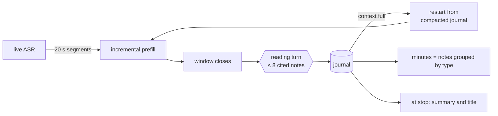

# meeting-summarizer

On-device meeting minutes for long zh-TW meetings, written **live on the phone** while the meeting is going on.

- **Input:** a 1.5–4 h meeting, transcribed by on-device ASR.
- **Output:** structured minutes (決議 · 待辦 · 保留 · 重要數字), a short prose summary and a title. Every item cites the transcript line it rests on.
- **Target:** OPPO Reno7 (Dimensity 900, 8 GB), CPU only, within a 3 GB RAM budget.
- **Model:** Gemma-4-E2B or E4B, fine-tuned and run in Google's mobile LiteRT-LM graph.

## Models

Current release: **mobile-v2** (2026-10-17).

| | E4B mobile-v2 | E2B mobile-v2 |
|---|---|---|
| notes contradicted by the transcript | **8–12 %** | 14–19 % |
| coverage of the reference points | 0.76–0.97 | 0.74–0.98 |
| peak RAM on the Reno7 (4k context) | 2.65 GB | **1.08 GB** |
| prefill / decode | 43 / ~4 tok/s | **118 / ~9 tok/s** |
| choose it when | faithfulness matters most | ASR and diarization need the memory |

Ranges are over three held-out domains; see [Evaluation](#evaluation).

| weights | contents |
|---|---|
| [Luigi/gemma-4-E4B-meeting-agent-zh-LiteRT](https://huggingface.co/Luigi/gemma-4-E4B-meeting-agent-zh-LiteRT) | `mobile-v2/`: `.litertlm`, fused graph (`mfa/`), system prompt, LoRA, merged safetensors |
| [Luigi/gemma-4-E2B-meeting-agent-zh](https://huggingface.co/Luigi/gemma-4-E2B-meeting-agent-zh) | the same for E2B; older releases (`mobile-v1/`, Q4_0 GGUFs) |
| [Luigi/gemma-3-270m-meeting-agent-zh-LiteRT](https://huggingface.co/Luigi/gemma-3-270m-meeting-agent-zh-LiteRT) | smoke-test model (290 MB): same protocol, too inaccurate for real use |

## Using it in an app

Follow the [integration note](docs/voxsumdroid-integration.md). It covers running ASR, diarization and summarization in parallel, the prompts, and file revisions. §15 is the mobile-v2 checklist.

- **Engine:** the [forked LiteRT-LM engine](https://github.com/vieenrose/LiteRT-LM/tree/mobile-fused-attention) fuses each attention block into one int8 op. It produces the same tokens as stock LiteRT-LM with half the memory (E4B: 2.65 GB instead of 4.58 GB).
- **Context:** use 4k. 8k costs 10–20 % of the speed for little gain.
- **CPU, not GPU:** the Reno7's Mali GPU needs fp32 activations, and is then slower than the CPU.

## How it works

- **One growing conversation.** ASR segments are prefilled as people talk, so when a window closes only the notes remain to generate.
- **Short context.** Prefill on a phone CPU slows down with depth. When the context is full, the conversation restarts from a compacted journal: decisions, open issues and actions first, then recent notes.
- **The minutes are the notes.** Small models merge and invent when they rewrite. The minutes are the notes grouped by type (`DECISION`, `ACTION`, `OPEN-ISSUE`, `NUMBER`).
- **At stop**, the same model turns the notes into a cited summary and a title.
- **Prompt rules that matter for a small model:**
  - short notes;
  - no ASR speaker labels, because they are unreliable;
  - no body or person that the excerpt does not name.
- **Guards:** the output length is capped, near-duplicate notes are rejected, and every citation must resolve to a transcript line.

## Training

1. **Teacher traces.** Qwen3.8-27B runs the same reading protocol on training meetings. A judge (Gemma-4-31B) checks every note against the transcript; turns with contradicted notes carry no loss.
2. **SFT on Google's mobile weights.** A LoRA is trained on Gemma-4 QAT mobile weights. It covers reading rows plus summary rows, with distillation from the teacher's next-token distributions. Domains: Legislative Yuan committee meetings (IVOD), AliMeeting business meetings and Taiwanese financial TV programs.
3. **On-policy distillation (mobile-v2).** The student reads 30 training meetings with the deployed harness. Gemma-4-31B scores the student's own rollouts with its top-20 distributions, and the student is trained on them.
4. **Export to the phone:**
   - **GPTQ onto Google's int2/int4 grid**, with Google's scales held fixed (`distill/gptq_mobile.py`). Plain rounding would erase the fine-tune.
   - **Injection** of the integers into Google's `.litertlm` (`distill/inject_litertlm.py`).
   - **Attention fusion** for the forked engine.

**What did not help:**
- DPO on teacher corrections;
- mechanical number checks;
- self-consistency;
- a second round of on-policy distillation.

The remaining errors are mostly *binding* errors: the right figure attached to the wrong year, article or body. They fall only with much larger models, so human review of decisions and key figures remains advisable.

## Evaluation

The evaluation uses 43 held-out meetings that never enter training:
- 10 financial TV programs;
- 13 Legislative Yuan committee meetings;
- 20 AliMeeting business meetings.

Gemma-4-31B judges each cited note against the transcript, from 30 s before its citation to 150 s after (`eval/judge_prose_tx.py`). Coverage is the share of reference points the notes recover. All runs use the forked engine on CPU with a 4k context.

| mobile-v1 → mobile-v2 | financial TV | Legislative Yuan | AliMeeting |
|---|---|---|---|
| E4B contradicted | 15.8 → **11.7 %** | 10.6 → **9.6 %** | 8.5 → **8.0 %** |
| E2B contradicted | 21.0 → **19.1 %** | 16.0 → **14.5 %** | 14.9 → **13.7 %** |
| E4B coverage | 0.65 → **0.76** | 0.96 → 0.97 | 0.96 → 0.91 |
| E2B coverage | 0.64 → **0.74** | 0.92 → 0.98 | 0.95 → 0.88 |

- **E4B:** contradicted notes fall significantly, by 1.5 points (95 % CI −2.9 to −0.2).
- **E2B:** the drop is within noise.
- **Both:** AliMeeting coverage falls, and the notes and summaries are longer.

## Data

Training data is built from noisy ASR transcripts, never from clean text, so the model learns to read what it will actually receive.

1. **Quality gates.** Transcripts are checked for language, repetition loops, length and ASR artefacts (`distill/v2_gates.py`).
2. **Teacher notes.** Each note must cite a real transcript line.
3. **Correction.** Defects are fixed only after a check against the transcript.
4. **ASR is kept as is.** Misheard words stay as the ASR wrote them; they are never "corrected" to real-world facts.

The training sets are not published, because the transcripts come from sources whose licences do not clearly allow redistribution. Only code, prompts and weights are released.

## Repository

| path | contents |
|---|---|
| `eval/realtime_agent.py` | the reading agent (chat API) |
| `eval/phone_live.py` | live phone driver: real-speed replay, incremental prefill, measured lag |
| `eval/judge_prose_tx.py`, `eval/judge_prose_notes.py`, `eval/section_precision.py` | transcript-grounded judge, summary fidelity, decision/action precision |
| `eval/conversion_prompts.py` | the app's summary and title prompts |
| `distill/sft_mobile_qat.py`, `distill/kd_teacher_logits.py` | LoRA training on the mobile weights, with distillation |
| `distill/gptq_mobile.py`, `distill/inject_litertlm.py` | export to LiteRT-LM |
| `summarizer/` | transcript ingest, windowing, citation resolution |

## Roadmap

- ASR, diarization and E4B together on the Reno7 within the memory budget.
- An in-process (JNI) engine for the Android app.
- Judged quality of notes produced on the phone itself.

## Appendix: version history

mobile-v1 (2026-10-03) and the llama.cpp versions v3–v11, measured on 38 held-out IVOD sessions. Kept for reference.

<b>mobile-v1: LiteRT-LM, on the phone's CPU, within 3 GB</b>

mobile-v1 runs the reader on [LiteRT-LM](https://github.com/google-ai-edge/LiteRT-LM), inside Google's own Gemma-4-E2B **mobile** graph: int2 MLP in layers 15–34, int4 elsewhere, an int8 KV cache and int8 static-range activations. It is built in three steps:
1. **Fine-tune on Google's mobile weights.** A LoRA trained on those weights distils v11: v11's top-32 next-token distributions plus the gold (`distill/kd_teacher_logits.py`, `distill/sft_mobile_qat.py --kd`).
2. **GPTQ onto Google's grid**, with Google's scales held fixed (`distill/gptq_mobile.py`). Rounding to the nearest integer would erase the fine-tune; GPTQ keeps it (validation loss 0.83 against 1.17).
3. **Injection** of the integers into Google's `.litertlm`, bit for bit, with fp32 GPU activations and the memory-hungry `prefill_1024` signature disabled (`distill/inject_litertlm.py`).

| Reno7, 4k context | llama.cpp v11 (8k) | **mobile-v1, CPU** |
|---|---|---|
| prefill | 8 tok/s at depth | **118 tok/s** |
| decode | 4–7 tok/s | **~10 tok/s** |
| peak RSS | — | **2.28 GB** |
| minutes contradicted (IVOD 38) | 17 % | 17 % |
| 決議事項 really decided | 71 % | 75 % |

**E4B mobile-v1** is built the same way on Google's Gemma-4-E4B mobile graph: 11 % of minutes contradicted, coverage 0.94, 待辦 really assigned 76 %, prose contradicting the notes 8 %, title 4.29. On stock LiteRT-LM it peaks at 4.58 GB; the forked engine brings it to 2.65 GB.

<b>v11: more precise decisions, better titles</b>

v11 is v8 plus a contrastive DPO (`distill/build_contrast_pairs.py`, `distill/dpo_agent.py`). The 2,700 pairs come from the teacher's verified notes, each with one note altered in one of the students' three dominant error types (`eval/contradiction_types.py`): the right fact on the wrong object, the wrong body or role, an inverted result.

| IVOD, 38 held-out sessions | v5 | v8 | **v11** |
|---|---|---|---|
| minutes contradicted | 18 % | 17 % | 17 % |
| coverage | 0.92 | **0.94** | 0.89 |
| 決議事項 really decided | 61 % | 62 % | **71 %** |
| 待辦 really assigned | 64 % | **68 %** | 66 % |
| title (1–5) | 4.18 | 4.05 | **4.21** |
| prose: sentences contradicting the notes | 9 % | 8 % | 8 % |

v11 lists fewer decisions, and more of them were really decided. In exchange it covers less of the meeting. Faithfulness is unchanged: the synthetic pairs taught the model to file fewer decisions, not to bind facts better. Weights in `v11/` of the Hugging Face repo; v8 stays for the widest coverage.

**Where the remaining errors come from** (`eval/contradiction_types.py`, share of all minutes statements). Binding (the right fact attached to the wrong year, article or body): 4.8 % for v8, 13 % for Qwen3.5-0.8B, ~20 % for the 1B-class models, 2.4 % for the 27B teacher. Attribution and inverted results add 3–8 % each. The rate is flat across window position, note order and note type: it is per-fact comprehension, not a context or restart artifact. Shorter windows, a lexical grounding filter and a mechanical attribution guard did not move it.

**Smaller students** (same data and protocol, LoRA SFT; IVOD 38): Qwen3.5-0.8B 31 % minutes contradicted (30 % after GRPO), coverage 0.83–0.86; Qwen3-0.6B 39 %; LFM2.5-1.2B 47 %; Hunyuan-0.5B 49 %; MiniCPM5-1B 50 %; Gemma-3-1B 52 %; Granite-4.0-350M 59 %. Qwen3.5-0.8B prefills ~3× faster than Gemma-4-E2B on a Raspberry Pi 4 and does not slow down with context depth (linear attention).

<b>v8: reading, prose and title in one model</b>

v8 is fine-tuned on all three jobs. The two conversion calls use VoxSumDroid's own prompts, byte for byte (`eval/conversion_prompts.py`). They are style conversions: the prose must say nothing the notes do not say.

- **Conversion SFT.** Qwen3.8-27B wrote a summary and a title for 543 training journals (`distill/convert_targets.py`). The judge checked each summary sentence against the notes (`eval/judge_prose_notes.py`). Only summaries with no contradicted sentence and the requested form were kept: 123 summaries and 540 titles (`distill/build_convert_sft.py`). They were added to the v5 reading data.
- **Multi-task GRPO** (`distill/grpo_multi.py`). 150 steps from that adapter, on 1,200 reading windows, 400 prose calls and 400 title calls. Qwen3.8-27B (NInfer) scores each sample (`distill/rl_rewards.py`):
  - reading: each note's faithfulness to the transcript, whether its DECISION / ACTION type holds, and recall of the teacher's notes, so writing less does not pay;
  - prose: each sentence's faithfulness to the notes, and form;
  - title: a 1–5 score.

  The KL is taken against the starting adapter. One GPU samples and trains, the other serves the judge.
- **A dead end.** A SFT variant (v7) that relabeled the teacher's note types and told the model to exclude the reading of minutes and rules gained a little precision, but lost coverage (0.92 → 0.88). RL kept the coverage and gained the precision.

| | v5 | **v8** | Qwen3.8-27B |
|---|---|---|---|
| **IVOD, 38 held-out sessions** | | | |
| coverage | 0.92 | **0.94** | |
| minutes contradicted | 18 % | **17 %** | |
| 決議事項 items really decided | 61 % | **62 %** | |
| 待辦 items really assigned | 64 % | **68 %** | |
| phone lag, worst case (model) | 24.9 min | **17.4 min** | |
| prose: sentences contradicting the notes | 9 % | **8 %** | 11 % |
| title (1–5) | 4.18 | 4.05 | 4.45 |
| **AliMeeting, 20 meetings (not in training)** | | | |
| coverage | 0.88 | 0.88 | |
| 決議事項 items really decided | 76 % | **79 %** | |
| 待辦 items really assigned | 66 % | **68 %** | |
| prose: sentences contradicting the notes | 19 % | **12 %** | 19 % |
| title (1–5) | 5.0 | 5.0 | 5.0 |

The prose of the 2B model is more faithful to the notes than its 27B teacher's, because it learned only from the teacher's faithful summaries. Titles are not yet better than v5's: the title reward barely varied within a sample group, so it gave the policy little signal. The weights are in `v8/` of the Hugging Face repo, with the same system prompt as v5.

<b>v5</b>

On AliMeeting business meetings, v3 filed proposals as decisions and listed every idea discussed as an action. v5 (`--harness v5`):
- adds a `PROPOSAL` type, filed under a 討論要點 section;
- makes `DECISION` (announced) and `ACTION` (assigned, or with a deadline) strict;
- reclassifies a decision or action worded as a proposal;
- was retrained on 163 IVOD sessions plus 217 AliMeeting meetings.

The weights are in `v5/` of the Hugging Face repo; v3 stays at the root. New measure: `eval/section_precision.py` asks the judge whether each 決議事項 item was really decided and each 待辦 item really assigned.

| | v3 | **v5** |
|---|---|---|
| **AliMeeting, 20 meetings (not in training)** | | |
| minutes contradicted | 16 % | 16 % |
| notes contradicted | 17 % | **14 %** |
| coverage | 0.86 | **0.88** |
| 決議事項 items really decided | 58 % (276 items) | **76 %** (117) |
| 待辦 items really assigned | 40 % (355 items) | **66 %** (138) |
| **IVOD, 38 held-out sessions** | | |
| minutes contradicted | 18 % | 18 % |
| coverage | 0.92 | 0.92 |
| 決議事項 items really decided | 51 % (904 items) | **61 %** (682) |
| 待辦 items really assigned | 53 % (1,097 items) | **64 %** (517) |
| gold decisions recalled (keyword-matched) | 83 % | 78 % |
| notes per session | 89 | 104 |
| phone lag, median / p90 / max | 2.8 / 4.9 / 17.6 min | 2.8 / 5.9 / 24.9 min |

With only the v5 prompt, the v3 weights reach the same precision on AliMeeting (79 % and 64 %) but lose coverage (0.79). Retraining keeps both. The rise in lag comes from v5 writing more notes on dense parliament sessions.

<b>First results (v3, llama.cpp)</b>

On 38 held-out IVOD sessions, judged by Gemma-4-31B against the transcript (`eval/judge_prose_tx.py`: each cited statement is checked from 30 s before its citation to 150 s after):

| | Gemma-4-E2B (v3) | Qwen3.8-27B (reference, 10 sessions) |
|---|---|---|
| minutes contradicted by the transcript | 18 % | 11 % |
| notes contradicted | 15 % | 10 % |
| coverage of the gold's key points | **0.92** | 0.88 |
| gold decisions recalled | **83 %** | 73 % |

The deployed configuration restarts from the compacted journal at 8k tokens, as on the phone. Against a 32k budget it loses nothing: 18 % contradicted in both cases, coverage 0.92 against 0.91, and decisions recalled 83 % against 77 %. The compacted journal puts decisions, open issues and actions back at the head of the context at each restart.

**Live on a Reno7 (v3, llama.cpp).** A 2 h 08 meeting was replayed at real speed:

| | |
|---|---|
| lag after each ~4 min window | **67 s median, 115 s max**, no drift |
| notes written | 80 |
| effective speed | prefill 16 tok/s, decode 4.5 tok/s |
| battery temperature | 30 → 37 °C over 2 h 10 |

