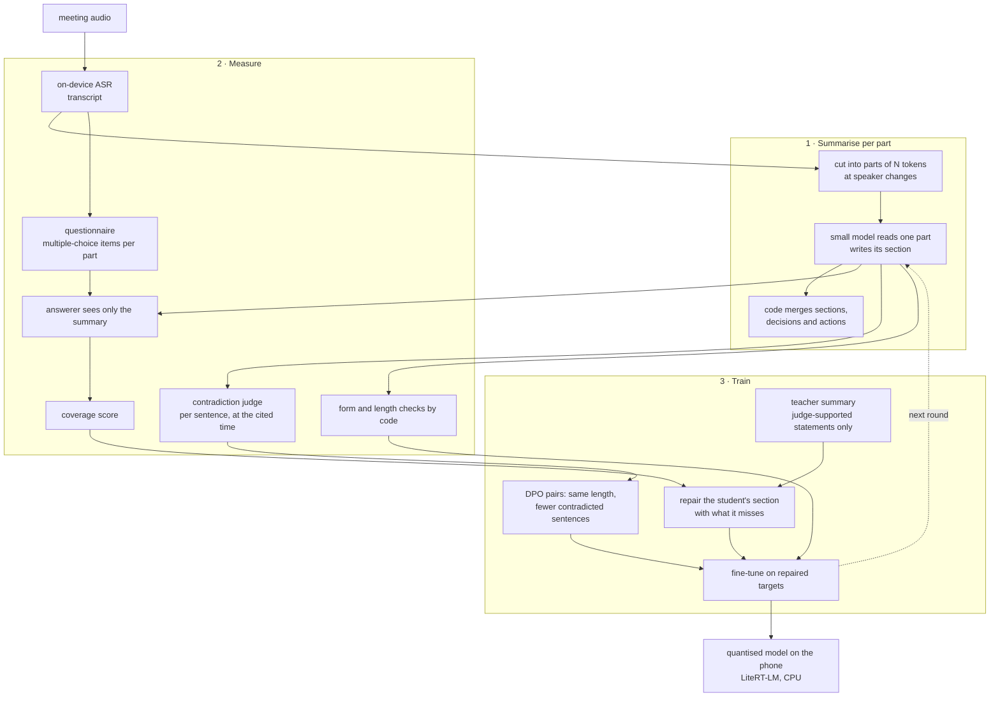

# Meeting Summarizer v5 (plan)

Reliable minutes for long meetings, produced **on the phone**, in real time, by a small model reading the meeting part by part.

The input is a 1.5–3 h zh-TW meeting (mixed with English) transcribed by on-device ASR. The output is a **multi-part summary**: one short section per part under a topic title, then decisions and actions gathered by code. Every statement cites the transcript time it rests on.

**Status, 2026-11-13: plan. v5 replaces the v4 / v4.5 drafts; nothing is released yet.**

## What a good summary is

| criterion | how it is checked |
|---|---|
| low contradiction / hallucination | per-sentence judge against the transcript around each cited time |
| high coverage | multiple-choice questionnaire over the whole meeting, scored per third |
| fixed length | total budget whatever the meeting length, checked by code |
| anchors for the fact checker | every sentence cites `[h:mm:ss]`, checked by code |
| readable, free of [issue #1](https://github.com/vieenrose/meeting-summarizer/issues/1) | topic titles, no journal-like listing, decisions and actions easy to find |

## Design rules

1. **Part size from effective context, not from the advertised window.** Small models read evenly only up to their effective context (RULER-style). We cut the transcript into parts of N ≈ 0.75 × effective context, at speaker changes.
2. **Real time means reading.** The phone must *read* (prefill) each part while the meeting runs: dense speech arrives at ≈ 21k tokens/h ≈ 6 tok/s, below CPU prefill speed. Writing may wait for the end of the meeting as long as it is short compared with the meeting. The lightweight on-device ASR shares the CPU, so the prefill needs margin over the speech rate.
3. **Fixed total length, shared across parts**, with a floor of ≈ 350–400 characters per part so each section stays readable; readability wins over length.
4. **Deployment:** LiteRT-LM, fully on CPU.

## Model ranges

Measured token rate of the transcripts (median): financial talks 21k tok/h, multi-speaker 21k (crosstalk-heavy sets up to 36k), legislative 14k.

| range | effective ctx (assumed) | part N | dense speech per part | parts for 2 h dense | length budget (total) | where |
|---|---|---|---|---|---|---|
| sub-2B (Gemma-4 E2B) | 16k | ≈ 12k | ≈ 35 min | 4 | 600 + 400 chars/h (to test) | Samsung Galaxy A53 |
| sub-4B (Bolt 4GB) | 32k (measured) | ≤ 32k | ≈ 70 min | 2 | **800 + 500 chars/h, cap 2200 (measured)** | Galaxy Note10+ |
| sub-7B | 64k | ≈ 48k | ≈ 135 min | 1 | 800 + 500 → test 1100 + 700 | phone if memory allows |
| 14B | 128k | ≈ 96k | ≈ 4.5 h | 1 | 1100 + 700, cap 2200 (to test) | server: ceiling and local teacher |

**Students.** Sub-4B: **Nemotron-3.5-Bolt-E4B (4 GB) is kept**; it is the current focus. Qwen3.5-4B was screened and dropped (30–43 % of sentences contradicted, against 13–20 % for Bolt). Sub-2B: Gemma-4 E2B (MiniCPM5-2B, LFM3-1.7B and Qwen3.5-2B all lost to it on contradiction); its sweep comes later.

**Bolt holds 32k, not 64k.** On legislative sessions of up to 65k tokens, one pass covers 0.51 against 0.64 for 32k parts; the middle and last thirds fall to 0.38 and 0.37 while the first holds. Bolt is never given more than 32k per pass.

Effective contexts are working assumptions: 2026 models rarely publish quality-at-length, and summarising (binding numbers to speakers across the meeting) is harder than retrieval. Each range's real N is measured (step 1 below).

## Plan

1. **Measure N per range.** Sweep part size (sub-2B 8k/12k/16k, sub-4B 16k/24k/32k, sub-7B 48k, 14B one pass) against one pass, at equal total length, 4 seeds, three domains. Pick N where the late thirds stop dropping below the first.
2. **Measure length per range.** Budgets 0.6× / 1× / 1.4×; keep the knee where +100 characters adds < +0.01 coverage or raises contradiction.
3. **Prompt and format per part:** topic title, carried titles of earlier parts, code-merged decisions and actions.
4. **Content training per part.** Repair the student's own summaries with judge-supported teacher statements (Claude Opus 5.5) for what they miss, behind a contradiction gate. The meeting-title task joins the same training mix: inputs are the section outlines of the student's own summaries, targets are titles written by Claude Opus 5.5 from the same outline and prompt, kept only if they pass the code checks (length, grounding in the section titles, no list of themes); measured by a pairwise judge (student title vs teacher title, outline only) and a human read.
5. **RL.** For format (length band, anchors, no repeats, valid end), and for content: DPO against contradiction, on pairs labelled per sentence by the contradiction judge (same length within ±10 %, supported coverage not lower, strictly fewer contradicted sentences). Pairs ranked by the questionnaire alone are not used (too noisy).
6. **Phone measurement:** real-time check (incremental prefill next to the ASR, then decode) and memory, on the A53 (sub-2B) and the Note10+ (sub-4B). The quantised model without the grammar is checked at this stage.

Release criterion: on all three domains, contradiction not higher than mobile-v2 and coverage not lower at matched length, length in budget, issue #1 closed by a human read.

Known limitation: there is no dense 2 h development set; the dense sets are 0.5–0.8 h long and the long one (legislative, 3 h) is sparse.

## Progress, 2026-11-13

- **Data cut per part** for N = 24k and N = 12k: 350 and 619 training parts, 61 and 111 development parts. Each part carries its transcript, the teacher statements the judge found supported (6,171 of 8,170) and its share of the questionnaire. Single ASR turns too long to cut are split at punctuation, text unchanged.
- **Repaired targets, whole-meeting version** (1,222 pairs): supported coverage rises from 0.59 to 0.86 on financial talks, 0.78 to 0.92 and 0.77 to 0.95 on multi-speaker sets, 0.23 to 0.43 on legislative sessions. First contradiction gate (financial talks): 3 % of sentences contradicted.
- **Step 1 done (sub-4B):** N = 32k for Bolt 4GB (see above).
- **Step 2 done (sub-4B):** length 1× (800 + 500 chars/h, cap 2200) kept. At 0.6× coverage falls by 0.10–0.13 (ali20 / msdev / legislative 0.57 / 0.43 / 0.55 against 0.70 / 0.56 / 0.64) and contradiction rises (16 / 23 / 23 % against 13 / 18 / 18 %). At 1.4× Bolt overshoots the budget (≈ 2× the 1× length, 3 of 13 legislative summaries in form) for no clear gain (0.69 / 0.55 / 0.67).
- **Step 3 started:** fewer topics per part (1–3 instead of 3–6) shortened the summaries to ≈ 0.6× budget and cost 0.13–0.19 coverage; a length-matched variant (2–4 longer topics) is running.
- **Meeting title (step 3).** Parts are summarised alone, so the whole-meeting title is written last: after the final part, the same model reads only the section titles with the first sentence of each (≈ 300–600 tokens, no transcript) and writes one title under a grammar (≤ 30 characters). Cost on the phone: a few seconds, after the meeting. Checked by code (length; share of title characters found in the section titles) and by a human read. First run on 23 dev meetings: titles cover the whole meeting, grounding 0.6–0.9 for most; open: titles cut at the 30-character cap (a hard cap stops mid-word), two titles name details not in the section titles (grounding 0.12, 0.38).
- **Carried titles (step 3, running).** Each part after the first gets the section titles already written for the same meeting, with the rule: write only this part, reuse a title when a topic continues, do not repeat earlier facts. It plays the role of mobile-v2's notes, much lighter:

  | | mobile-v2 journal | v5 carried titles |
  |---|---|---|
  | content | notes with facts, numbers, cited times | section titles only |
  | role | source of the final summary (rewritten from the notes) | avoid repeats, keep titles consistent; each section is already final |
  | size | grows with the meeting | a few dozen tokens |
  | final pass | full rewrite | code merge (plus the meeting title) |
  | phone cost | high (the agent was slow) | near zero |

  Each fact is written once, straight from the transcript: every rewrite of a fact is a chance to bind a number to the wrong speaker, the main measured cause of contradiction. If titles are not enough, the next level carries the earlier sections themselves (a few hundred characters, already part of the final summary).
- Speculative decoding with NVIDIA's DFlash drafter for Bolt: no gain under the form grammar, −26 % time without it (2.1–2.5 tokens per step on zh-TW); kept for later deployment tests only.
- **Open:** at N = 12k the questionnaire is thin per part on legislative sessions (25 of 347 parts have no question); more questions are needed there.

## Progress, 2026-11-14 to 11-16

- **Step 3 closed:** 3–6 topics per part, no carried titles. The meeting title is written from the section titles plus their first sentence.
- **Seed noise.** Generation on the GPU with llama.cpp is not deterministic. The same base model with the same seeds moves 1–2 points of contradiction between two batches. From now on, every arm is compared with a base generated in the same batch, or with 8 seeds.
- **Rewrite-pair DPO (closed, no gain).** Pairs where the judge verified each edit gave contradiction ali20 14.8 % and msdev 18.0 %. The base over 8 seeds was ≈ 12.7 % and 16.5 %. A control with shuffled labels scored the same, so the pairs carry no signal.
- **Best-of-8 by questionnaire is noisy.** Most of the score comes from which questions were drawn and from length. The held-out gain is only +0.02 to +0.05.
- **Prompt "one fact per sentence, explicit actor" fails:** contradiction ali20 15.5 % (base 13.0 %), msdev ≈ 23 % (base 17.5 %), with 12 % more sentences.
- **Deploy path checked.** Our own imatrix Q4 gives 13.3 / 17.0 % contradiction (ali20 / msdev), against 13.0 / 17.5 % for NVIDIA's Q4. Merging a LoRA and requantizing therefore costs nothing.
- **Phone (A53, app engine with fused attention, Bolt 4GB, CPU only):**

  | context | prefill | decode | memory |
  |---|---|---|---|
  | 4k | 36.3 tok/s | 3.67 tok/s | 2.6 GB |
  | 32k | 12.4 tok/s | 1.33 tok/s | 2.83 GB |

  Real time holds: processing takes no longer than the meeting.
- **New goal: one-pass Bolt beats mobile-v2 (the E4B agent) on contradiction.** Today the gap is 5–10 points (base Bolt: ali20 13 %, msdev 17.5 %, legislative ≈ 19 %). The plan has four steps:
  - **S0:** re-judge mobile-v2 with the same judge and settings.
  - **S1:** extract, then write.
  - **S2:** verify each sentence and delete the bad ones, reusing the part's KV cache.
  - **S3:** distil the repaired outputs back into the generator.
- **S2 gate 1 fails zero-shot.** Bolt answering 是/否 for each of its own sentences against the part transcript separates contradicted from supported sentences poorly:

  | domain | AUC (target 0.80) |
  |---|---|
  | multi-speaker | 0.69 |
  | financial talks | 0.61 |
  | legislative | 0.65 |

  On financial talks, deleting by this score removes as many supported sentences as contradicted ones.
- **Running:**
  - A listwise verifier LoRA, trained on 39k sentences labelled by the judge. One call per part, after the generation; its prefix is the cached KV of the base model.
  - The S0 re-judging of mobile-v2.
  - More pool seeds (5–8).

## Example: one meeting, input and output

What the current pipeline does with one real meeting. The model is Bolt 4GB, Q4, with no fine-tuning: none of the training rounds beat the base model, so the base is still the best checkpoint. The settings are the ones used in the evaluation: one pass per 32k-token part, the RD prompt with its grammar, length 1×, seed 1. The meeting is AliMeeting `R1019_M1954`, from the ali20 dev set. It is a public Mandarin corpus, converted to Traditional characters. Two speakers plan a company trip, the meeting lasts 33:18, and the ASR output is used as-is, without correction. Here the meeting fits in a single part.

<details><summary>Input: full ASR transcript (16,585 characters)</summary>

```text
[0:02] S1: 呃，鄧霞，我就是這次叫你來開會，就是關於就是公司半年半年度出遊的計劃。
[0:09] S1: 然後，今天我們兩個做過內部的就是，嗯，會議嘛。
[0:13] S1: 問一下，就是我提前段時間給你提過，我們公司的預算是十萬，然後有一百號員工，我們科室。
[0:20] S1: 你是怎麼計劃的呢？
[0:22] S2: 呃，一百個人的話。
[0:24] S2: 我建議還是部分出遊。
[0:27] S2: 比如說像我們這半年的話。
[0:29] S2: 呃，有個優秀員工的一個。
[0:32] S2: 表現比較好的。
[0:34] S2: 評選出來之後，我們會給到他一個這個旅遊方案，我們會統一。
[0:38] S2: 去安排。
[0:40] S2: 但是我覺得十萬。
[0:41] S1: 唉，不對呀，我們有一百號人我沒有說過，必須就是是優秀員工啊。我一百號人如果平平攤下來，每個人有一千塊錢左右，我們去。
[0:50] S1: 就是，比較近的地方可以呢？
[0:53] S1: 為什麼你必須要有優秀員工？如果比如說一百號人。
[0:57] S1: 我們有優秀的員工，現在只有就是二十號人，那剩下的八十號人那怎麼去的？
[1:04] S1: 這樣就就區別待遇，其他的人怎麼辦呢？
[1:07] S2: 呃，如果你是建議一百個人都出遊的話。
[1:10] S2: 那人均只有一千塊錢。
[1:13] S2: 一千塊錢的話，就在周邊遊嘛。
[1:14] S1: 一千塊錢可以呀。
[1:16] S1: 對呀，周邊有可以啊，我之前有跟你說過的嘛，周邊周邊有可以啊，我們可以。嗯，做旅行團也可以，也可以旅行團辦。
[1:24] S1: 就是半旅行團辦就是自由行啊。
[1:27] S2: 這個也是可以的。
[1:29] S2: 那這樣子吧，我們就。
[1:30] S2: 我就給你這樣子計劃吧，就一百個人。
[1:33] S1: 怎麼計劃？
[1:34] S2: 一百個人的話就十萬塊錢，人均就是一千。
[1:37] S2: 一千的話，我們周邊遊差不多就是玩個兩天時間。
[1:41] S2: 那這一千塊錢的費用的話。
[1:43] S2: 那裡面還是涵蓋這個。
[1:45] S2: 呃，景點的住宿啊。
[1:47] S2: 還有就是。
[1:49] S2: 車旅費。
[1:51] S1: 那那你那你我問一下就是你這一百號人，你你就是說一百號人去跟團嗎？
[1:51] S2: 門票。
[1:57] S1: 但是一百號人的就是安全性，怎麼保證呢？
[2:01] S2: 這個可以買一個保險啊。
[2:03] S1: 買保險哦，反正我們公司也有嘛，對吧。
[2:06] S1: 這我知道。
[2:07] S1: 但是這一把百號人，你是分批次還是一起都去呢？
[2:18] S1: 你是分批次，還是直接就去？
[2:21] S2: 覺得還好吧，一百個人出遊。
[2:23] S2: 可以。
[2:24] S2: 可以一起去。
[2:26] S2: 然後。
[2:26] S1: 一一起去吧，那如果這所有，九十九個人都需要你去負責他們安全，你能負責嗎？
[2:27] S2: 對。
[2:36] S1: 我知道，但是我跟你說過，這一百號人，我的建議還是分批去。
[2:42] S2: 嗯，這樣也可以。
[2:43] S1: 那那個你你給我大概說一下，你之前有選給我報過幾個地點，你覺得去哪裡，比較合適呢？
[2:50] S2: 哦，大概給你說一下吧。
[2:52] S2: 現在就是，比較火的。
[2:54] S2: 這個旅遊熱線呢，是那個。
[2:57] S2: 普格縣的一個溫泉。
[2:59] S2: 那邊有那種彩虹瀑布。
[3:06] S1: 那跟團，你知道是多少錢嗎？
[3:08] S2: 呃，這個的話要下來再問一下。
[3:11] S2: 因為我做的方案的話，可能是一個自由行的，因為自由行還比較好玩一些。
[3:14] S1: 自由行，那那那你有沒有，就是那種旅遊公司直接可以包車的那種。
[3:19] S2: 這個有啊，這個都是可以找到的，我有旅遊方面的朋友。
[3:21] S1: 但是。
[3:22] S1: 但是我們之前就是我們公司，就是之前我們的。呃呃，領導都去過。
[3:28] S1: 領導都去過這個地方。
[3:30] S1: 然後給我們。
[3:30] S2: 覺得好不好玩嗎？
[3:40] S1: 如果。
[3:40] S2: 這個專案還比較單一對吧？
[3:49] S1: 還有其他的地方啊。
[3:51] S2: 行，我記一下。
[3:51] S1: 這個你可以先。
[3:52] S1: 你可以先記一下，比如說西餐，有哪些玩的。
[3:55] S1: 比如說，可以帶他們的小漁村。
[3:57] S1: 小漁村裡面有就是有吃的，有魚有吃的，比如說。
[4:01] S1: 呃，還有魚啊，這些都可以，還有他們的醉蝦啊。你可以做一個。
[4:06] S1: 做一個就是分析。
[4:08] S1: 比如說哪些可以吃呢？就是還有他們那邊的水果很出名，你可以把，西餐的哪些景點，你要你自己要有個路線的規劃。
[4:17] S2: 這沒問題啊。
[4:18] S1: 但是你去西餐，然後你怎麼去？你剛我跟說跟團，跟你還是自己安排，還是去。
[4:25] S1: 呃，嗯，怎麼安排。
[4:28] S2: 嗯，我個人建議的話。
[4:30] S2: 就是還是我們自由行。
[4:32] S1: 自由行。
[4:32] S2: 自由行我們是這樣子的，如果是包這個大巴開車過去的話。
[4:36] S2: 他的車程的話，只有六個半小時。
[4:40] S2: 坐坐火車呀，坐高鐵啊，這都是可以的。
[4:43] S1: 呃，我我我大概知道，一個現在一個大巴車的大巴車是三十九人，到四十九人。
[4:51] S1: 嗯，我我我，因為我以前也做過旅遊方面的嘛？就是一個三十九的車，大概要租四千。
[4:58] S1: 一個四十九的車，四十九人的車要租四千五百，四千五百。
[5:03] S1: 包括郵費下來的話，三十九人的就大概五千五百塊錢。
[5:08] S1: 五千五百塊錢，然後。
[5:10] S1: 那個就是四十九人的，應該就是六千塊錢。
[5:13] S1: 你六千塊錢，如果你是比如說我們去。
[5:16] S1: 我們有一百號人，一百號人有可能也有人去不了的嘛，可能就省掉二十個人，你就相當於五十個人。
[5:20] S2: 嗯，對。
[5:23] S1: 五十個人你至少要兩個車。
[5:25] S1: 兩個車，一個還有再再準備，再準備兩個私家車，是吧。
[5:31] S1: 兩個私家車，是因為平時有其他的事情，需要自駕車去處理的。
[5:36] S1: 然後就需要兩個車。
[5:37] S1: 兩個車包下來，基本就是一萬二的支出了。
[5:41] S1: 你剩下的你十萬塊錢。
[5:43] S1: 減去一萬二，就只有八八萬八。
[5:46] S1: 剩下你怎麼安排？
[5:49] S2: 這些。
[5:51] S2: 住宿，住宿這一塊兒。
[5:53] S1: 住宿住宿，我們上次去的那個普格的，那個溫泉溫泉，就是。
[5:59] S1: 酒店嘛，他是兩星的，沒有三星，他們那邊比較偏遠。
[6:03] S1: 兩星的是，二百八十塊錢，一個標間。
[6:07] S1: 我們一般標間嘛，因為就是那麼多人。
[6:10] S1: 你算過二百八十塊錢。
[6:12] S1: 然後是。
[6:14] S1: 比如說去八十個人八十個人，是除以二。
[6:18] S1: 然後四十個。
[6:18] S2: 四十四十間嗎？
[6:19] S1: 四十間，四十間，然後四八三十二。
[6:26] S2: 一萬一千多嘛。
[6:27] S1: 對啊，你就。
[6:27] S2: 還可以給他砍一下價。
[6:29] S1: 你相當於這裡就已經。
[6:30] S2: 就算一萬一吧。
[6:37] S1: 二百五的話就剩下了，就是七萬多。
[6:41] S2: 對，還門票費嘛。
[6:43] S2: 還有吃啊這些。
[6:46] S1: 我我我覺得應該這個還可以。
[6:48] S1: 但是呢，這個有個缺點哈。
[6:51] S1: 有個缺點在哪裡呢？就是說。
[6:53] S1: 你的交通方式，這個安全性比較。
[6:56] S1: 比較複雜了，因為為什麼，因為我們上次去的是冬天去冬天去的路。
[7:01] S1: 在路路況不是很好。
[7:02] S2: 他冬天肯定路不好啊，像現現在去的話比較合適啊。
[7:06] S1: 對我知道，但是這個交通方式的話，就是說你的你的大概的意思，就是我們自己去找大巴。
[7:11] S2: 我建議，我對對對。
[7:13] S2: 我建議我們找兩個大巴，而且他們都是經常跑那條線的。
[7:13] S1: 去找大巴，是吧。
[7:17] S2: 安全性的話都還是挺高的。
[7:19] S2: 我建議就是，不用開私家車過去。
[7:22] S2: 畢竟就是說路線這些不熟悉的話，也存在一個安全隱患。
[7:24] S1: 嗯，但是但是呢，但是我覺得你必須要，確定一下，你就現在跟，就是跟我們就是科室的人。
[7:31] S1: 確定一下，比如我們把時間定一下定成，五月中旬，比如說十五號，還是十八號星期六星期天。
[7:38] S1: 就這兩個時間定時間點，就比如說是。
[7:40] S2: 對對對，週末的話，可能去的人還要還還是比較多一點。
[7:44] S2: 我這樣子吧，我先確認一下。
[7:46] S2: 呃，去能夠去的人。
[7:48] S2: 然後我再聯絡大巴車，然後給他們砍一下價。
[7:52] S2: 再瞭解一下那邊。
[7:54] S1: 這個我覺得我剛剛跟你提的那個，就是三十九人，然後四十九人，在我說的這個還是我朋友的那個內部價呢？我之前就給他聯絡過了。
[8:03] S1: 然後，你這個價格，可能是沒有沒有什麼太大的出入。
[8:07] S1: 然後還有一個關於，那個那個住宿的事情，網上的也是以前我們在網上訂的，我看過，因為我們以前也出去過，所以說。
[8:15] S1: 這個價格應該是沒有什麼太大優勢的。
[8:24] S2: 其他地方的話，我現在還沒有。
[8:28] S2: 剛剛說的是西昌普格縣還比較可以。
[8:29] S1: 我之前不是有有給你推過一個嘛，九寨溝的包團的七百九十八。
[8:34] S1: 對吧，那個就不需要，你需要就是包團，你什麼都不用管。
[8:39] S2: 七百九十八。
[8:40] S1: 對，而且是做的三星酒店還可以，我覺得。
[8:44] S1: 呃，裡面包括了很多東西。
[8:46] S1: 但是有沒有我當時給你交代的。
[8:49] S1: 叫你自己去。
[8:49] S2: 你說七百九十八那個是住幾晚啊？幾天幾晚啊？
[8:53] S1: 三天。
[8:54] S1: 三天兩夜。
[8:55] S2: 三天兩夜。
[8:56] S1: 對。
[8:58] S1: 你當時我當時給你交代的，為什麼你都沒有做好了？
[9:02] S2: 當時可能在忙嘛，還沒有去處理到這一塊兒。
[9:11] S1: 我怎麼了解這個是我給你交代的事情，為什麼你叫我瞭解，我只能給你提個大概的。
[9:18] S2: 行行。
[9:18] S1: 到底我是領導，還是你是領導。
[9:21] S2: 七百九十八三天兩夜。
[9:23] S2: 他有哪些景點啊？我下來。
[9:25] S2: 我查一下啊。
[9:29] S1: 這個事情我其實你大概給你瞭解過了。
[9:32] S1: 他是這樣的，就是。
[9:33] S1: 嗯，它包括就是吃飯，中餐嘛，每天就是三天的啊，午餐中餐還早餐，都都已經就是已經準備的。
[9:42] S1: 然後最重要的問題是什麼呢？
[9:44] S1: 那個，他們這個包團的七百九十八，有個比較好，就是不會強制消費。
[9:49] S1: 因為，他不會讓你去買一些不該買的東西。
[9:53] S2: 現在強制消費這一塊的話，應該也不會了。
[9:53] S1: 然後。
[9:56] S1: 哎呀，反正我們這邊公司員工，我覺得他們收入還可以，就算這樣叫他們去買點東西呢，我覺得他們應該也會去買的。
[10:03] S2: 就是我覺得你這個建議還是比較好。
[10:06] S2: 就是如果是報團的話，他們就是。
[10:12] S1: 就一一次性就可以去玩嗎？
[10:13] S2: 一百個人的話，就我算就七百九十八就算八百嘛。
[10:17] S2: 一百個人的話，就是八萬塊錢。
[10:19] S1: 對，然後剩下的兩萬塊錢，我們可以買些買些水呀。
[10:26] S1: 但是，這個這個有個問題啊，包團嘛？包團你肯定就剛剛你說的。
[10:31] S1: 雖然說的是不會強制買東西，但是我肯定你過去過後。
[10:35] S1: 你七百九十八，你要做要做好的吃好的，肯定去消費的時候，你他們要為他們做一些貢獻。
[10:41] S1: 這個你到時候你要去跟我們的員工宣導一下。
[10:44] S2: 他買東西，是算他們自己的呀。
[10:46] S1: 對我知道我知道。
[10:47] S1: 但是這個呃。
[10:49] S1: 嗯，這個九寨溝這個包團七百九十八，我也沒有，就是過多的去跟旅行團瞭解，對，這個也需要你去了解為什麼。
[10:53] S2: 據瞭解，對吧。
[10:57] S1: 包括他的那個人員的，就是安全問題，你要去了解一下。
[11:01] S1: 啊，還有他們會不會買保險啊，這些。
[11:04] S1: 就是如果他們不會買，我們自己公司，原我們反正也是平安的嘛。我們自己可以給我們的員工買。
[11:10] S1: 但是買這個費用，也要算在這個成本里面。
[11:13] S1: 你有沒有算過這個東西。
[11:15] S2: 對對對。
[11:16] S2: 覺得跟團還比較好。
[11:18] S1: 啊嗯，還有就是一個問題哈。
[11:21] S1: 結果最大的問題是什麼呢？就是說。
[11:23] S1: 有可能五月中旬，我去不了這個東西，然後就需要你這個助理。
[11:28] S1: 去幫我去，嗯，去把所有的就溝通的，比如說帶員工去如何去活躍一下氣氛啊，這些都需要你去啊。
[11:36] S1: 比如晚上晚上那邊，比如九寨溝那邊晚上，有篝火晚會呀。
[11:40] S1: 這些也需要你去，所以說我真的。我現在給你下發一個很重要的任務，就是。
[11:46] S1: 你現在必須要把。
[11:47] S1: 九寨溝，如果去九寨溝有哪些專案？
[11:50] S1: 然後，有沒有我們自己可以去，就是單獨去參加的專案，比如說啊。
[11:55] S2: 呃，我建議那邊的，他那邊的篝火晚會還不錯。
[11:58] S2: 但是我估計就我們這個。
[12:00] S2: 就是七百九十八，他是不包含那個篝火晚會的。
[12:04] S1: 啊，我不知道。
[12:05] S2: 因為他還要吃那種烤全羊啊，這種。
[12:07] S1: 所以我的意思就是，我的意思就是，我這個也是朋友提給我提的，我就是我把電話給你，你自己去跟他了解一下，這個七百九十八，到底包括哪些東西？
[12:07] S2: 人均的話。
[12:21] S1: 一百號人，他這個七百九十八肯定還有優惠啊，或者他會在其中增加一些，其他的專案，你可以去。
[12:28] S1: 那個溝通一下。
[12:29] S2: 嗯，這個可以。
[12:35] S1: 我之前有聽你說過，就是那個。
[12:38] S1: 青城山。
[12:39] S1: 青城山的這個專案。
[12:41] S1: 你覺得怎麼樣？青城山，但是我覺得沒什麼青城山，都江堰沒什麼好耍的，然後還有那個就是。
[12:47] S1: 呃，峨眉山。
[12:48] S1: 峨眉山怎麼樣？
[12:50] S1: 峨眉山的後山也可以。
[12:52] S2: 峨眉山，人均下來，因為上次有朋友去過。
[12:55] S2: 呃，就住了一一個晚上。
[12:58] S1: 對。
[12:58] S2: 呃，包括金頂的那個門票費。
[13:01] S1: 啊對。
[13:01] S2: 還有。
[13:05] S2: 就是兩天時間也來得及。
[13:07] S1: 那大概你覺得一個人需要花多少錢？
[13:07] S2: 頭天去住一晚。
[13:09] S2: 第二天早上一早，然後去看那個。
[13:11] S2: 峨眉山金頂的，日出，呃，去看日出。
[13:15] S2: 看完了之後，然後就回來。
[13:17] S2: 有跟團也可以自由行。
[13:19] S1: 我覺得。
[13:20] S1: 呃，我覺得峨眉。
[13:21] S1: 應該是不用跟團的吧，那麼近的地方還是要跟團嗎？這個就。
[13:25] S2: 那就需要，單獨去包。
[13:27] S2: 包兩輛那個，大巴車。
[13:37] S2: 也不便宜，人均下來至少還是要五六百。
[13:37] S1: 對吧。
[13:41] S1: 五六百這個。
[13:42] S1: 唉，那你。
[13:43] S2: 都算便宜了五六百的。
[13:48] S2: 對。
[13:52] S1: 六百塊錢的人均嘛。
[13:54] S2: 對，六百兩天。
[13:55] S1: 你要五百兩天。
[13:57] S1: 然後但是有個問題哈，我要問你。
[14:07] S1: 知道嗎？
[14:08] S1: 嗯，安全是第一嘛？
[14:10] S1: 然後這個就，這個就必須要我們公司內部買那個六十塊錢。
[14:14] S2: 對，我們自己去的話，就自己買。
[14:15] S1: 公司內部不是有個那個六十塊錢的，那個安全嘛，就是個人個人安全險對吧？
[14:21] S2: 嗯，對。
[14:23] S1: 然後這個就是一百號人也有六千塊錢的，這個就有個成本。
[14:27] S2: 六千。
[14:28] S1: 這個成本在這裡，然後。
[14:30] S1: 嗯，然後還有其他什麼問題嗎？你覺得還會，我們會遇到哪些問題？
[14:38] S2: 這樣子吧。
[14:39] S2: 我們現在就是九寨溝。
[14:42] S2: 還有。
[14:44] S1: 梁山的。
[14:44] S2: 峨眉山。
[14:45] S1: 呃，還有西餐是吧？
[14:45] S2: 西昌，對，我覺得還是讓他們自己來選吧。
[14:49] S1: 我覺得。
[14:50] S2: 投票吧。
[14:51] S1: 投票嘛。
[14:53] S2: 因為有的地方，比如說有可能九寨溝啊，他們有的去過呀，或者峨眉山去的人可能也比較多，去過的人哈。
[14:58] S1: 去投票呃，可以我就投票這個方式可以。然後我們去搞個這個，比如說明天開會的時候。
[15:05] S1: 明天早上，就是九點鐘開會，然後跟他們一開一個大會，然後他讓他們。
[15:09] S1: 就做個那個。
[15:11] S1: 呃，選擇嗎？
[15:12] S2: 對，這樣子的話，大家積極性比較高一些。
[15:19] S1: 但是。
[15:20] S1: 呃，我覺得這個，我覺得峨眉山可以做備選，但是我們像我估計大部分大部分都去過了，要不然再做個備選呢？
[15:27] S2: 我沒去過。
[15:29] S1: 你沒去過，你沒去過。
[15:30] S1: 是你沒去過，但是有其他人沒去有很多人去過，因為他就在附近嗎？
[15:35] S1: 然後還有一個是那個。
[15:40] S1: 有沒有去過呢？
[15:42] S2: 這個我是去過的，我不知道其他人去過沒有，對。
[15:45] S1: 蜀南竹海，我覺得也可以做備選。
[15:48] S1: 因為這個地方嘛，空氣比較好，然後就是大家也可以去。
[15:53] S1: 在那邊去感受一下那邊的環境嘛。
[15:56] S2: 還是比較遠。
[15:57] S1: 遠大概車程是多少，我沒我還沒去過呢。
[15:58] S2: 對。
[16:01] S2: 估計還是要開十多個小時吧。
[16:04] S1: 好像，沒有那麼遠吧。
[16:07] S1: 我聽他們說是七個小時就能到嗎？
[16:10] S2: 七個小時哈。
[16:11] S1: 啊七個小時。
[16:13] S2: 不建議去那邊，因為開車啊，開七個小時還是麻煩。
[16:17] S2: 也沒什麼好玩的。
[16:20] S2: 那邊沒有什麼好玩的呀。
[16:21] S1: 沒什麼好玩的嗎？
[16:22] S2: 就是進山裡就去看一片竹林。
[16:25] S1: 但是。
[16:25] S2: 還要爬山。
[16:26] S1: 但是他們可以到宜賓，那邊去就吃一下當地的美食啊。
[16:33] S1: 沒沒啥好吃的，那們再換個地方吧。
[16:37] S2: 我覺得，應該選一些，我下來再選一些就是。
[16:37] S1: 然後。
[16:41] S2: 最近比較火的，大家沒去過的地方。
[16:44] S1: 不是最近又出現了那個網紅地嘛，網紅地那個什麼？
[16:50] S1: 等我想一下，在那個簡陽那邊的嘛，不是簡陽，有個什麼網紅店你去過沒有。
[16:56] S2: 嗯，沒有沒有。
[17:03] S1: 還有都江堰嘛。
[17:05] S1: 我覺得要不然把那個青城山也可以做備選嗎？要是有些人想去青城山呢？
[17:10] S2: 青城山爬山。
[17:12] S1: 青城山爬山。
[17:14] S1: 我這一次的目的呢，我們公司的目的除了讓你們出去玩兒之外，你們也可以出去鍛鍊一下自己啊，爬個山也不錯啊。
[17:22] S1: 然後青城山前山可以耍後後山也可以耍啊。
[17:25] S1: 為什麼你不可以啊？
[17:32] S1: 開會之前我跟你說，你必須要把這些地點給我做一個就是。
[17:36] S1: 計劃。
[17:37] S1: 結果你什麼計劃的沒有弄。
[17:40] S1: 你知道，你需要一弄一下計劃好不好。
[17:42] S1: 然後我們這樣吧，我們先。
[17:50] S2: 西昌嘛，或者是那個九寨溝嘛。
[17:56] S2: 附近的話，人家週末自己就去玩了。
[17:59] S1: 那你你是說峨眉山比較近嘛？附近別人都可以去。
[18:00] S2: 沒有什麼吸引力啊。
[18:04] S2: 峨眉山有的週末兩天也去了呀，我我建議就是九寨溝啊。
[18:08] S2: 這兩個嘛，九寨溝跟西昌嘛。
[18:11] S1: 哎呀，這樣吧，我反正就是，你剛剛你不是說的，我明天開會的時候，讓他們投個票，看一下是那個西昌九寨溝。峨眉山。
[18:19] S1: 然後宜賓蜀南竹海，我們就就是就不用去了吧，因為你剛剛說沒什麼玩的，我們就。
[18:24] S1: 就刪掉這個部分。
[18:25] S1: 然後我們明天去一下，就是明天去給他們溝通一下，西昌。
[18:30] S1: 然後，九寨溝峨眉山。
[18:31] S1: 但是我們現在來就看一下。
[18:36] S1: 其他區域，然後包車，然後也是一個有意外險有六千塊錢的，這個你大概算一下。
[18:42] S1: 我大概算了一下，需要多少的成本哈。
[18:45] S1: 然後租車是。
[18:48] S1: 租車是一萬一萬多少呢？
[18:50] S2: 一萬，五吧。
[18:52] S1: 一萬五是吧。
[18:54] S1: 一萬五，然後加上六千的就是那個保險。
[18:58] S1: 然後再加上那個住宿，大概我一算呢，應該是。
[19:03] S1: 多少？
[19:04] S1: 多少也是一萬二左右對吧。
[19:06] S2: 嗯，對。
[19:12] S1: 然後，還有你還要在西昌市裡面待一天是吧。
[19:16] S1: 那那天也也大概也是一萬二吧。
[19:19] S1: 就是二萬四的。
[19:21] S1: 二萬四。
[19:22] S1: 我們必須算一下看到底我們需要多少？
[19:25] S1: 然後到時候吃住吃住，我看大概算一下。
[19:29] S1: 一個總共去八十個人。
[19:32] S1: 八十個人的話，每桌大概是五百塊錢嘛，最低的五百嗎？
[19:39] S1: 五百五八四十就是四萬。
[19:42] S1: 四萬。
[19:44] S1: 四萬的支出了。
[19:45] S2: 五百塊一桌人嗎？
[19:47] S1: 對。
[19:51] S2: 還是八個人一桌？
[19:51] S1: 對啊。
[19:53] S1: 十個人一桌啊。
[19:54] S2: 十個人一桌，那就是十桌。
[19:56] S1: 對十桌啊。
[19:57] S2: 我覺得五百可能不太夠。
[19:59] S1: 不夠嗎？
[20:00] S2: 不夠。
[20:00] S1: 我覺得還可以吧，你先。
[20:02] S2: 要訂個八百的。
[20:02] S1: 你肯定去。
[20:07] S2: 十桌八百就八千塊錢。
[20:08] S1: 八千八千但是你要有四天啊，你要。
[20:16] S2: 早餐的話，他們就自己吃。
[20:20] S1: 不可能你出去了，你們連早餐我們去住宿裡面，是包括了包括了早餐的。
[20:25] S1: 包括了二萬一。
[20:27] S1: 五塊二萬一。
[20:34] S1: 那個四萬就是六萬五。
[20:36] S2: 這樣子算嘛，人均一一餐就是。
[20:37] S1: 六萬五。
[20:39] S2: 八十塊錢，正餐。
[20:46] S1: 然後大概就是八萬七左右。
[20:49] S1: 跟我們十萬塊錢差不多。
[20:54] S2: 還有門票啊，這些你算了嗎？
[21:02] S2: 泡溫泉那個是免費嗎？
[21:04] S1: 對泡溫泉，他們是免費的。
[21:06] S1: 你就八十個人嘛，八二八四六一八九九千六，就將相當於九萬多這樣。
[21:13] S1: 我這次你們這次的就是旅遊，我再給你們一萬塊錢，我自我個人掏一萬塊錢給你們。
[21:20] S1: 然後作為就是你們的，呃，相當於給你們的一個獎勵嘛。
[21:29] S1: 嗯，你們可以就是說去買買飲料買酒，那些時候你買好一點。
[21:35] S1: 然後我去給你們就是。
[21:37] S1: 你如果你這一方面，你如果沒有認識的人，到時候我也可以給你說一下我們朋友，他們賣酒的也會給你。
[21:43] S1: 反正我這一萬塊錢拿給你去開支。
[21:45] S1: 然後。
[21:50] S1: 如果多出，比如說他那個吃住行。
[21:53] S1: 多出我反正多了一萬，但是你這個，如果你這個費用超出了我可不管啊。
[21:58] S2: 嗯，這個沒問題，我會有一個預算表的。
[21:58] S1: 這就是。
[22:00] S1: 這個我就跟您說得很清楚，你必須要，提前給我做個預算。
[22:04] S1: 之前我前段時間就跟你說過，叫你提前做過預算，你現在沒有做好，這個就是你的問題了，對吧。
[22:10] S1: 你作為現任，你作為我的助理。
[22:12] S1: 作為助理，每次跟你開會的時候，你每次你都都沒弄好。
[22:16] S1: 所以說這個是你的工作。
[22:18] S1: 然後去九寨溝，我們也大概算呢，七百九十八一個人是吧？
[22:22] S2: 對。
[22:29] S1: 就一百號人全部去吧。
[22:31] S1: 全部去的話就是七萬九是吧。
[22:34] S2: 就算八百一個人嘛。
[22:35] S1: 對啊，就七萬九。
[22:37] S2: 一百個人的話，就是八萬塊錢。
[22:39] S1: 對八萬塊錢吶。
[22:40] S2: 這還剩兩萬。
[22:45] S2: 包團它是有門票，但是的話，像參加篝火晚會。
[22:50] S2: 或者是烤全羊這些，是按人頭算的。
[22:53] S2: 至少的話，人均是在。
[22:55] S2: 一百。
[22:56] S2: 對。
[22:57] S1: 一百拉下來。
[22:57] S2: 所以說，一這一百個人的話，這又是一萬塊錢啊。
[23:01] S1: 就是相當於就是九萬呢，就反正我跟你說嘛，這次嗯，反正我給你們贊助一萬塊錢。
[23:01] S2: 對。
[23:02] S2: 對。
[23:07] S1: 因為我們今年上半年做的就是業績，也做得比較好，反正我給你拿一萬塊錢出來算給你們獎勵吧。
[23:13] S1: 就作為就是公司的，就是。
[23:15] S1: 福利嘛，我也給你們一個福利。
[23:17] S1: 然後唉，但是就是這邊就總共就差不多嘛。就這幾個。
[23:23] S1: 呃，九寨溝西昌，但是峨眉山是六百塊錢一個人，我覺得這個應該就比較少了吧，你就。
[23:29] S2: 這樣子這樣子啊，你說的這個七百七百九十八其實它是包括。
[23:34] S2: 兩天晚上的住宿，還有門票。
[23:36] S2: 還有。
[23:38] S2: 吃飯這些嘛，午餐啊晚餐。
[23:39] S1: 對啊。
[23:41] S2: 這個，這個標格還是比較低。
[23:43] S2: 他也他也有九九八的九九八的。
[23:49] S2: 我。
[23:49] S2: 也不是說多的錢我來給，我肯定也沒有這個錢給呀。
[23:54] S2: 大家就是說吃的好一點，住的也要好一點。
[23:57] S2: 不能太差啦。
[24:00] S1: 九十八已經是三星酒店呢？
[24:02] S1: 難道你不可能做九百九十八？我我以為我給你提供啊？九百九十八也也是三星的我覺得都差不多啊。為什麼要去。
[24:10] S2: 這樣子吧，我先把這兩個方案做出來，然後對比。
[24:14] S2: 對比出來，你自己來選。
[24:16] S1: 我剛剛給你說了，不是我來選，是大家來選這個是民主的，對吧。
[24:22] S1: 是不是啊。
[24:22] S2: 這個是民主的呀，但是這個中間。
[24:28] S1: 就那個我跟你說那個備選就是峨眉山，你做一下備選，為什麼？因為峨眉山要近一點有些人，他沒法去，覺得近一點還好一點。所以說我覺得。
[24:38] S1: 你把峨眉山這個六百的人均。
[24:56] S2: 嗯，對。
[25:01] S2: 人均八百差不多。
[25:02] S1: 對呀，人均八百啊，你就把這個這個標準也給我提一下，所以說就是說你這個，你這個提前就應該有個計劃。
[25:10] S1: 然後現在我給你開了這個會，就人均計劃也。
[25:16] S1: 嗯，就是峨眉山也七百嘛。然後反正。
[25:20] S1: 不管去哪兒，我都給你們一萬塊錢的這個。
[25:24] S1: 補助嘛。
[25:25] S1: 然後。
[25:26] S1: 還有就是這次。
[25:27] S1: 我覺得如果說我們去的人數如果沒有超過一百人，只有八十個人。
[25:35] S2: 這樣子嘛，我們也可以就是，他們有的可能會帶家屬去。
[25:39] S1: 哦不行，這個帶家屬。
[25:40] S2: 啊他們他們自費他們自費，就是家屬的要去的話就自費嘛。
[25:45] S1: 你有沒有想過一個問題？如果帶家屬，比如說我們現在是八十個人去。
[25:50] S1: 八十個，如果有一半的人帶一個。
[26:00] S2: 領導，他是這樣子的。
[26:01] S2: 因為如果她一個人出去玩的話，可能也。
[26:05] S2: 就是，有很多人他也會陪家人。
[26:08] S1: 對我覺得。
[26:08] S2: 他自費呀，他。
[26:10] S2: 多出來的人，比如說人均是八百，他就出八百塊一個人。
[26:12] S1: 這個。
[26:13] S1: 我告訴你，公司半年度出遊的就意義在哪裡呢？意義在於是員工與員工之間的相互溝通。
[26:21] S1: 對吧。
[26:22] S1: 我們事情目的是這樣，不是讓你帶家屬出去玩的。
[26:26] S2: 哎，我覺得怎麼這麼，不人性化呢？
[26:29] S1: 不是不人性化。
[26:29] S2: 這個這個上面我們就有分歧了，很多公司都是說可以帶家屬，但是費用是。
[26:34] S2: 自費的。
[26:35] S1: 但是你這個費用你怎麼算，我問你你怎麼算這個費用？
[26:40] S2: 很好算啊。
[26:43] S2: 比如說人均八百或者是九百嘛。
[26:45] S2: 對吧。
[26:46] S2: 然後他多。
[26:47] S2: 帶一個人去的話。
[26:48] S2: 什麼？
[26:56] S1: 你有沒有想過，如果你去，比如說在西昌是自由行，你每一多一個人，你的成本就會增加一點兒。
[27:03] S2: 我們肯定要把每個人他的吃住行全部。
[27:06] S2: 就說預算好。
[27:08] S2: 人均是多少，然後我們再去收這個費用。
[27:19] S2: 他可以自己買保險啊。
[27:21] S1: 保險本來這個就是公司給的福利，然後給他福利他會隱形的，讓人感覺你唉。
[27:27] S1: 我我家屬跟我去，又想應該享受公公司的福利呀，我為什麼還要家屬出這個錢呢？
[27:33] S2: 意味著這次公司他只有這一些。
[27:36] S2: 就說這個預算，給到員工的獎勵。
[27:39] S1: 員工獎勵這不是獎勵，這個是福利。
[27:42] S1: 獎勵跟福利還是有區別的。
[27:45] S1: 對吧。
[27:46] S2: 看他們自己嘛。
[27:48] S1: 那就比如說我問你。
[27:49] S1: 你現在你媽媽，你爸爸，你還有你小孩。
[27:53] S1: 你會不會把三個人都帶上啊，哎，我比如說我跟你說帶西昌去七八百塊錢。
[27:57] S1: 呃，很便宜啦，你肯定會帶你父母去對吧？
[28:01] S2: 不一定啊，不一定，我不一定會。
[28:01] S1: 我就問你。
[28:10] S2: 暫時不去，主要是有事兒。
[28:13] S1: 我們現在不是有，就是已經說了去這三個三個的地點嗎？
[28:18] S1: 但嗯，然後這個三個地點，我們費用還有成本，這些大概也算了，是吧。
[28:23] S2: 算啊，嗯。
[28:23] S1: 對不對。
[28:24] S1: 嗯，我們算了一下，但是有有個問題哈，我問你了。
[28:28] S1: 就是公司的這個，就是。
[28:30] S1: 嗯，是決定了已經是自己包車還是跟團，你覺得。
[28:35] S1: 你覺得這個跟團跟就是大巴的，就是。
[28:38] S1: 自己找大巴，你覺得優缺點，你跟我說大概說一下。
[28:41] S2: 跟團的話，他可能就是。
[28:44] S2: 呃，吃的呀，住的呀，可能沒這麼。
[28:51] S2: 自由行的話，他要自由一點。
[28:53] S2: 呃，時間的話就是他可以玩的地方啦。
[28:56] S1: 嗯，那那你要給我確定一下，如果。
[28:56] S2: 要多一些。
[28:59] S1: 如果。
[29:01] S1: 如果公司就是。
[29:06] S1: 如果公司你就是租大巴，你就注意一下員工的，就是安全好不好。
[29:11] S2: 可以可以，我下來給你一個方案嘛。
[29:22] S2: 嗯，好的好的。
[29:23] S1: 好。
[29:34] S1: 嗯，就是我剛剛就是有個問題，還沒有給你說就是關於就是租大巴的事情，你要去。
[29:40] S1: 問一下那邊。
[29:47] S1: 因為為什麼因為我我這個朋友這邊他是。
[29:51] S1: 沒有公司的，我我剛剛問了。
[29:53] S1: 你趕緊問一下有沒有其他的旅遊公司。
[29:56] S1: 可以開發票的，然後價格大概是這個底兒的。
[29:59] S1: 這個點。
[30:00] S1: 然後不會超出這個預算。
[30:12] S1: 我但是普格那邊你問一下那邊的溫泉酒店。
[30:15] S1: 問一下他們會不會開發票，比如說你在網上團購團購是便宜點，還是在就是那個打電話去團購便宜點。
[30:24] S1: 然後這些東西必須要有發票的對吧。
[30:27] S2: 嗯，對。
[30:27] S1: 然後。
[30:35] S2: 現在的思路，一個是那個，跟團，一個就是，自由行嘛。
[30:45] S2: 我偏向於去哪兒？
[30:48] S2: 這個也不是我說了算啊，要大家選啊。
[30:52] S2: 我說了也不算。
[30:54] S1: 是因為什麼我為什麼問你？嗯，偏向性的啊。因為明天去的是我們不是要出去玩嘛，你肯定要給我做過ppt。
[31:10] S1: 比如你現在還有半個月的時間。
[31:12] S1: 半個月一定要，比如說他們要乾的怎麼好，我們才能出去啊，要讓他們在這半個月有銷售的勢頭，對吧？
[31:21] S2: 這個PPT的話，晚上可以做。
[31:23] S1: 晚上可以做是吧，這個ppt就是內容一定要豐富，而且要多找一些圖片，讓他們改改造一下。就比如說那裡有怎麼怎麼好啊？讓他們就是。
[31:38] S1: 然後就讓公司。
[31:39] S1: 要一定要讓他們感恩公司，公司對他們的福利待遇是非常好的，知道嗎？
[31:44] S2: 我們到時候可能還要做一個橫幅。
[31:48] S2: 對。
[31:51] S1: 你你現在做橫幅，明天能。
[31:54] S1: 能忙過來嗎？
[31:55] S2: 你明天又不是出遊啊。
[32:00] S2: 對。
[32:04] S2: 服裝要不要統一呢？
[32:06] S1: 我們不是有嗎？我們那個公司不是發的體恤的嘛，一個粉紅色的。
[32:12] S2: 哦，穿那個也可以。
[32:12] S1: 還有一個橘色的兩個平安的標誌的吧。
[32:16] S2: 那行。
[32:18] S2: 到時候大家統一下服裝。
[32:20] S1: 唉可以可以可以，到時候我覺得這個。
[32:24] S1: 你不拿我們後勤的人員都會給我們準備的對吧。
[32:29] S1: 然後還有就是我再看一下。
[32:35] S1: 然後。
[32:40] S1: 好吧，我們反正我現在時間也快到了。然後我們就總結一下吧，就是今天我們就是大概定了去三個三個地方。
[32:50] S1: 嗯，在明天的就是大會上會跟他們做個宣導。
[32:57] S1: 費用啊，那些所有的東西都走。
[33:01] S1: 然後我們。
[33:02] S2: 沒問題，嗯。
[33:03] S1: 啊，反正今天的內容，我們地點已定的，然後時間也定嘛，我們就定在就是十五號嘛。
[33:10] S1: 或者是十八號，就這兩個時間點。
[33:13] S2: 可以。
[33:14] S1: 嗯，然後。
[33:15] S1: 嗯，好吧，今天我們的會議就到這裡吧。
[33:17] S2: 嗯，好的。
[33:18] S1: 嗯，好拜拜。
```
</details>

**Output: the final summary, unedited:**

## 預算與參與人數規劃

公司半年度出遊的預算是十萬 [0:13]。該科室共有一百號員工 [0:13]。S1 建議若平攤至一百號人，每人約一千塊錢 [0:41]。S2 提出部分出遊給優秀員工的方案，但 S1 強調所有一百號人都應納入考量 [0:34]。若全體出遊，人均一千塊錢適用於周邊兩天遊 [1:10]。此外，公司提供個人安全險，費用為六十塊錢/人，一百號人總成本為六千塊錢 [14:15]。

## 旅遊方案比較與建議

S2 初步建議普格縣溫泉，有彩虹瀑布，但 S1 提議多考慮其他地點如西昌、九寨溝、青城山及峨眉山 [2:57]。S1 曾推薦九寨溝包團七百九十八，為三天兩夜且包含三星酒店 [8:29]。峨眉山人均約五六百，兩天時間可看金頂日出，建議自由行而非跟團 [13:05]。S2 偏向自由行，認為更具彈性 [4:30]。S1 最終建議由員工投票決定地點，選項包括西昌、九寨溝和峨眉山 [18:11]。九寨溝的包團（八百/人）計算後，一百人總計八萬塊錢，剩餘兩萬可用於額外開支 [22:37]。

## 交通與住宿成本估算

若選擇自由行並包車，三十九人車約四千，四十九人車約四千五百 [4:51]。一百人需至少兩輛大巴車，加上兩個私家車，總支出約一萬二 [5:37]。普格溫泉兩星酒店標間二百八十塊錢，八十人共四十間，約一萬一千多 [6:18]。若以西昌為例，包車（兩天）及住宿（兩天）預估總成本約二萬四 [19:19]。若選九寨溝包團，一百人總費用約九萬多，加上 S1 個人補助一萬塊錢，總預算符合十萬限制 [21:06]。若以八十人計算，吃住行總成本約六萬五，加上門票後約八萬七，接近十萬預算 [20:49]。

## 決定

- 地點將透過明天大會讓員工投票決定，選項包含西昌、九寨溝及峨眉山 [15:05]
- 確定出遊時間點為五月中旬的十五號或十八號 [33:03]

## 待辦

- S2 需整理並製作九寨溝方案的 PPT，內容豐富並鼓勵員工感恩公司福利 [31:10]
- S2 需向朋友確認九寨溝七百九十八包團包含細節，如篝火晚會是否包含 [12:07]
- S2 需聯繫旅遊公司，詢問可開發票的包車價格，確保不超出預算 [29:56]
- S2 需準備並提交詳細的預算表給 S1 [22:00]

**What the contradiction judge (Qwen3.8-27B) found.** Of the 19 sentences it judged, 13 are supported by the transcript, 3 are contradicted and 3 are unsupported.

- **Strengths.** The structure is clear. Every number and quote can be traced to a timestamp. The budget, head count and transport prices are correct. The vote between three destinations and the actions assigned to S2 are captured.
- **Contradicted (3).** All three are the typical failure: correct numbers placed in the wrong frame.
  - [13:05] Emei Shan: the summary says free travel was recommended. In the transcript, S1 asks whether a tour group is needed, S2 answers with the cost of a chartered bus, and nothing is concluded.
  - [21:06] The summary says the Jiuzhaigou total fits the 100k budget. S1 actually says that any overrun is not their problem; the fit is never agreed.
  - [20:49] The summary links 65k and 87k in a way the speakers did not: 65k is the total including lodging, 87k includes the meals.
- **Unsupported (3).**
  - The list of destinations at [2:57]. That passage names only 西昌, which the ASR wrote as 西餐; Jiuzhaigou, Qingcheng Shan and Emei Shan come up later in the meeting.
  - A 24k cost estimate whose basis is mixed up.
  - The decisions and actions block. The May 15 or 18 date and the PPT are in the transcript, at [7:31], [31:21] and [33:03]; the judge only looked at the passages around the cited timestamps, so this flag is mostly a false alarm from the judge, not an error in the summary.

On this dev set, the error rate of this meeting is close to the model's average (ali20: 13 % contradicted). The verify-and-delete pass (S2) aims to remove sentences like the three above.

## Measurement and training signal

**Idea.** A good summary is good in form and in content.

- *Form* (sections, length, timestamps) is enforced by a grammar and checked by code.
- *Content* is measured two ways: a questionnaire (a reader who holds only the summary should answer questions that cover the meeting) and a per-sentence contradiction judge.



**Questionnaire.** Questions are written per equal-time slice so the end of the meeting weighs as much as the start; for v5 they are assigned to parts by their timestamp. Each item has four options plus "not in the summary"; wrong options are other numbers, people or outcomes from the same meeting, so a wrong binding is caught. Items answerable without any text are dropped. A small answerer model picks a letter from the summary alone; grading is a letter comparison.

**What v4 taught us (whole-meeting one pass).**

- *Scoring.* A fast multiple-choice judge (d3-turbo, kappa 0.91 against the large reference judge, 15–25× faster) scores the questionnaire. It cannot replace the per-sentence contradiction judge (kappa 0.26).
- *Pair labels are noisy.* With ~17 questions per meeting, the best of 8 samples wins mostly by question-draw luck: held-out gain is only +0.02–0.05. A DPO round on such pairs was null on 4 seeds.
- *Coverage is the driver.* An item is answered 63–70 % of the time when the summary cites a moment within 2 minutes of it, and 9–17 % otherwise. Bolt puts 65 % of its citations in the first third of long sessions (position bias).
- *Length alone is not a lever.* For the sub-4B student, shorter budgets cost −0.04 to −0.05 and longer ones gain at most +0.04; spreading citations by prompt lost 0.07–0.19. Giving it the right facts (oracle) gains +0.2 to +0.3 at equal length: fact selection is the gap.
- *Teacher.* Claude Opus 5.5 (low effort) answers 0.64 of the questions vs 0.44 for the previous teacher, with fewer contradicted sentences (20 % vs 32 %). It now writes the reference summaries for the whole training pool (212 meetings). Only its sentences that the judge finds supported are reused.

## Layout

| path | contents |
|---|---|
| `eval/onepass_summary.py` | one-pass summary with the form grammar |
| `eval/qa_build.py`, `eval/qa_mcq.py` | questionnaire builder; multiple-choice conversion |
| `eval/qa_score.py`, `eval/qa_score_mcq.py` | open-answer and multiple-choice scoring |
| `eval/judge_prose_tx.py`, `eval/judge_prose.py` | contradiction judge; coverage judge |
| `scripts/qa_metric.sh`, `scripts/qa_spread.sh`, `scripts/qa_mcq.sh` | validation runs of the questionnaire score |

## Evaluation

Every round is read on three held-out sets (financial talks, legislative sessions, multi-speaker meetings) with several seeds:

- **Contradicted rate** (`eval/judge_prose_tx.py`): each sentence is checked against the transcript around its timestamp and labelled supported, contradicted or unsupported.
- **Coverage** (`eval/judge_prose.py --units`): share of reference points the summary carries.
- **Questionnaire score** (v4): correct, wrong and abstained answers, by third of the meeting and per 1000 characters.

ASR output is never corrected; long meetings are never excluded.

## Released model and earlier work

The model currently released is **mobile-v2**, a reading agent with an external journal on Gemma-4-E2B/E4B. Its model card, app integration and results are in [docs/mobile-v2.md](docs/mobile-v2.md); older versions are in [docs/version-history.md](docs/version-history.md).

The agent is reliable but slow on a phone. v4 replaced it with one pass of a smaller model; v5 keeps one pass but per part, sized to the model. Nothing from v4 / v5 is released yet.

## Status

Research, not production. Steps 1–3 done; content training (step 4–5) gave no gain so far; current work is the verify-and-delete pass (S2) toward beating mobile-v2 on contradiction. Still to do: human evaluation and Note10+ heat measurement.
