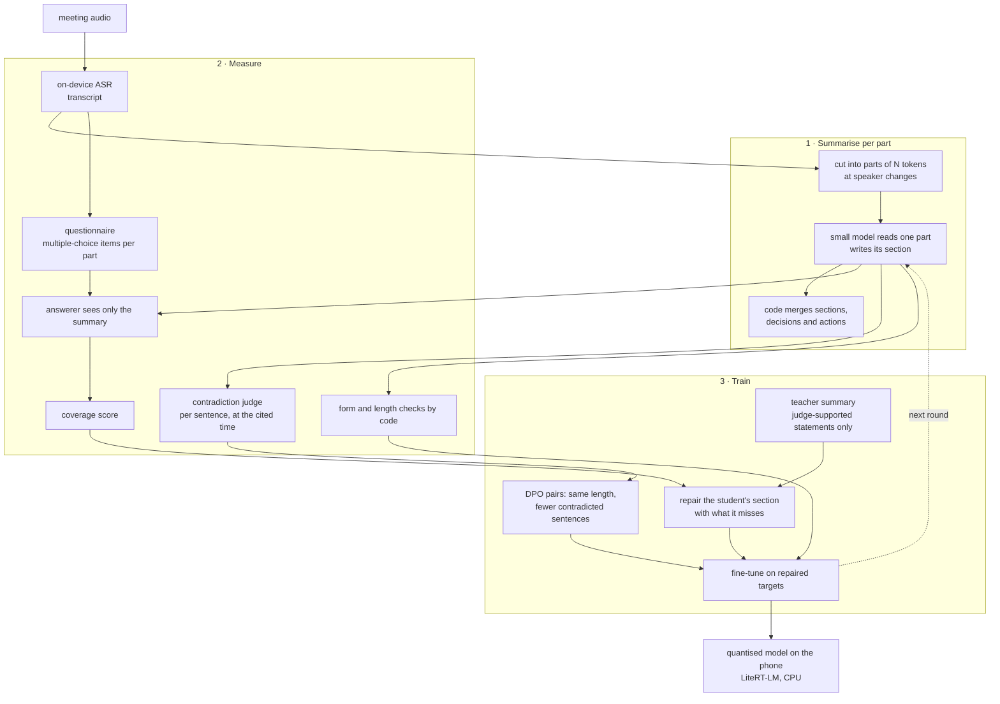

# Meeting Summarizer v5 (plan)

Reliable minutes for long meetings, produced **on the phone**, in real time, by a small model reading the meeting part by part.

The input is a 1.5–3 h zh-TW meeting (mixed with English) transcribed by on-device ASR. The output is a **multi-part summary**: one short section per part under a topic title, then decisions and actions gathered by code. Every statement cites the transcript time it rests on.

**Status, 2026-11-13: plan. v5 replaces the v4 / v4.5 drafts; nothing is released yet.**

## What a good summary is

| criterion | how it is checked |
|---|---|
| low contradiction / hallucination | per-sentence judge against the transcript around each cited time |
| high coverage | multiple-choice questionnaire over the whole meeting, scored per third |
| fixed length | total budget whatever the meeting length, checked by code |
| anchors for the fact checker | every sentence cites `[h:mm:ss]`, checked by code |
| readable, free of [issue #1](https://github.com/vieenrose/meeting-summarizer/issues/1) | topic titles, no journal-like listing, decisions and actions easy to find |

## Design rules

1. **Part size from effective context, not from the advertised window.** Small models read evenly only up to their effective context (RULER-style). We cut the transcript into parts of N ≈ 0.75 × effective context, at speaker changes.
2. **Real time means reading.** The phone must *read* (prefill) each part while the meeting runs: dense speech arrives at ≈ 21k tokens/h ≈ 6 tok/s, below CPU prefill speed. Writing may wait for the end of the meeting as long as it is short compared with the meeting. The lightweight on-device ASR shares the CPU, so the prefill needs margin over the speech rate.
3. **Fixed total length, shared across parts**, with a floor of ≈ 350–400 characters per part so each section stays readable; readability wins over length.
4. **Deployment:** LiteRT-LM, fully on CPU.

## Model ranges

Measured token rate of the transcripts (median): financial talks 21k tok/h, multi-speaker 21k (crosstalk-heavy sets up to 36k), legislative 14k.

| range | effective ctx (assumed) | part N | dense speech per part | parts for 2 h dense | length budget (total) | where |
|---|---|---|---|---|---|---|
| sub-2B (Gemma-4 E2B) | 16k | ≈ 12k | ≈ 35 min | 4 | 600 + 400 chars/h (to test) | Samsung Galaxy A53 |
| sub-4B (Bolt 4GB) | 32k (measured) | ≤ 32k | ≈ 70 min | 2 | **800 + 500 chars/h, cap 2200 (measured)** | Galaxy Note10+ |
| sub-7B | 64k | ≈ 48k | ≈ 135 min | 1 | 800 + 500 → test 1100 + 700 | phone if memory allows |
| 14B | 128k | ≈ 96k | ≈ 4.5 h | 1 | 1100 + 700, cap 2200 (to test) | server: ceiling and local teacher |

**Students.** Sub-4B: **Nemotron-3.5-Bolt-E4B (4 GB) is kept**; it is the current focus. Qwen3.5-4B was screened and dropped (30–43 % of sentences contradicted, against 13–20 % for Bolt). Sub-2B: Gemma-4 E2B (MiniCPM5-2B, LFM3-1.7B and Qwen3.5-2B all lost to it on contradiction); its sweep comes later.

**Bolt holds 32k, not 64k.** On legislative sessions of up to 65k tokens, one pass covers 0.51 against 0.64 for 32k parts; the middle and last thirds fall to 0.38 and 0.37 while the first holds. Bolt is never given more than 32k per pass.

Effective contexts are working assumptions: 2026 models rarely publish quality-at-length, and summarising (binding numbers to speakers across the meeting) is harder than retrieval. Each range's real N is measured (step 1 below).

## Plan

1. **Measure N per range.** Sweep part size (sub-2B 8k/12k/16k, sub-4B 16k/24k/32k, sub-7B 48k, 14B one pass) against one pass, at equal total length, 4 seeds, three domains. Pick N where the late thirds stop dropping below the first.
2. **Measure length per range.** Budgets 0.6× / 1× / 1.4×; keep the knee where +100 characters adds < +0.01 coverage or raises contradiction.
3. **Prompt and format per part:** topic title, carried titles of earlier parts, code-merged decisions and actions.
4. **Content training per part.** Repair the student's own summaries with judge-supported teacher statements (Claude Opus 5.5) for what they miss, behind a contradiction gate.
5. **RL.** For format (length band, anchors, no repeats, valid end), and for content: DPO against contradiction, on pairs labelled per sentence by the contradiction judge (same length within ±10 %, supported coverage not lower, strictly fewer contradicted sentences). Pairs ranked by the questionnaire alone are not used (too noisy).
6. **Phone measurement:** real-time check (incremental prefill next to the ASR, then decode) and memory, on the A53 (sub-2B) and the Note10+ (sub-4B). The quantised model without the grammar is checked at this stage.

Release criterion: on all three domains, contradiction not higher than mobile-v2 and coverage not lower at matched length, length in budget, issue #1 closed by a human read.

Known limitation: there is no dense 2 h development set; the dense sets are 0.5–0.8 h long and the long one (legislative, 3 h) is sparse.

## Progress, 2026-11-13

- **Data cut per part** for N = 24k and N = 12k: 350 and 619 training parts, 61 and 111 development parts. Each part carries its transcript, the teacher statements the judge found supported (6,171 of 8,170) and its share of the questionnaire. Single ASR turns too long to cut are split at punctuation, text unchanged.
- **Repaired targets, whole-meeting version** (1,222 pairs): supported coverage rises from 0.59 to 0.86 on financial talks, 0.78 to 0.92 and 0.77 to 0.95 on multi-speaker sets, 0.23 to 0.43 on legislative sessions. First contradiction gate (financial talks): 3 % of sentences contradicted.
- **Open:** at N = 12k the questionnaire is thin per part on legislative sessions (25 of 347 parts have no question); more questions are needed there.

## Measurement and training signal

**Idea.** A good summary is good in form and in content.

- *Form* (sections, length, timestamps) is enforced by a grammar and checked by code.
- *Content* is measured two ways: a questionnaire (a reader who holds only the summary should answer questions that cover the meeting) and a per-sentence contradiction judge.

**Questionnaire.** Questions are written per equal-time slice so the end of the meeting weighs as much as the start; for v5 they are assigned to parts by their timestamp. Each item has four options plus "not in the summary"; wrong options are other numbers, people or outcomes from the same meeting, so a wrong binding is caught. Items answerable without any text are dropped. A small answerer model picks a letter from the summary alone; grading is a letter comparison.

**What v4 taught us (whole-meeting one pass).**

- *Scoring.* A fast multiple-choice judge (d3-turbo, kappa 0.91 against the large reference judge, 15–25× faster) scores the questionnaire. It cannot replace the per-sentence contradiction judge (kappa 0.26).
- *Pair labels are noisy.* With ~17 questions per meeting, the best of 8 samples wins mostly by question-draw luck: held-out gain is only +0.02–0.05. A DPO round on such pairs was null on 4 seeds.
- *Coverage is the driver.* An item is answered 63–70 % of the time when the summary cites a moment within 2 minutes of it, and 9–17 % otherwise. Bolt puts 65 % of its citations in the first third of long sessions (position bias).
- *Length alone is not a lever.* For the sub-4B student, shorter budgets cost −0.04 to −0.05 and longer ones gain at most +0.04; spreading citations by prompt lost 0.07–0.19. Giving it the right facts (oracle) gains +0.2 to +0.3 at equal length: fact selection is the gap.
- *Teacher.* Claude Opus 5.5 (low effort) answers 0.64 of the questions vs 0.44 for the previous teacher, with fewer contradicted sentences (20 % vs 32 %). It now writes the reference summaries for the whole training pool (212 meetings). Only its sentences that the judge finds supported are reused.

## Layout

| path | contents |
|---|---|
| `eval/onepass_summary.py` | one-pass summary with the form grammar |
| `eval/qa_build.py`, `eval/qa_mcq.py` | questionnaire builder; multiple-choice conversion |
| `eval/qa_score.py`, `eval/qa_score_mcq.py` | open-answer and multiple-choice scoring |
| `eval/judge_prose_tx.py`, `eval/judge_prose.py` | contradiction judge; coverage judge |
| `scripts/qa_metric.sh`, `scripts/qa_spread.sh`, `scripts/qa_mcq.sh` | validation runs of the questionnaire score |

## Evaluation

Every round is read on three held-out sets (financial talks, legislative sessions, multi-speaker meetings) with several seeds:

- **Contradicted rate** (`eval/judge_prose_tx.py`): each sentence is checked against the transcript around its timestamp and labelled supported, contradicted or unsupported.
- **Coverage** (`eval/judge_prose.py --units`): share of reference points the summary carries.
- **Questionnaire score** (v4): correct, wrong and abstained answers, by third of the meeting and per 1000 characters.

ASR output is never corrected; long meetings are never excluded.

## Released model and earlier work

The model currently released is **mobile-v2**, a reading agent with an external journal on Gemma-4-E2B/E4B. Its model card, app integration and results are in [docs/mobile-v2.md](docs/mobile-v2.md); older versions are in [docs/version-history.md](docs/version-history.md).

The agent is reliable but slow on a phone. v4 replaced it with one pass of a smaller model; v5 keeps one pass but per part, sized to the model. Nothing from v4 / v5 is released yet.

## Status

Research, not production. Still to do: plan steps 1–6, human evaluation, and measurement on the Note10+ / A53 (speed, heat).
