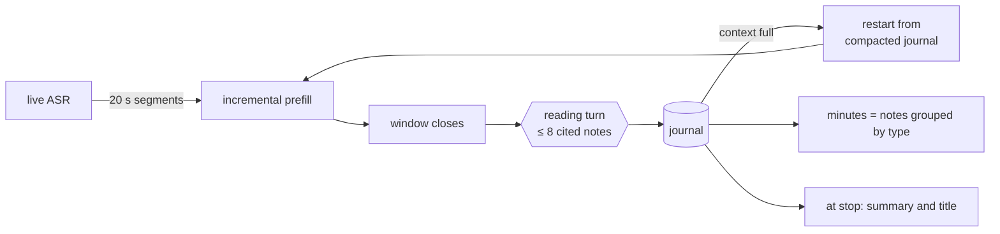

# meeting-summarizer

On-device meeting minutes for long zh-TW meetings, written **live on the phone** while the meeting is going on.

- **Input:** a 1.5–4 h meeting, transcribed by on-device ASR.
- **Output:** structured minutes (決議 · 待辦 · 保留 · 重要數字), a short prose summary and a title. Every item cites the transcript line it rests on.
- **Target:** OPPO Reno7 (Dimensity 900, 8 GB), CPU only, within a 3 GB RAM budget.
- **Model:** Gemma-4-E2B or E4B, fine-tuned and run in Google's mobile LiteRT-LM graph.

## Models

Current release: **mobile-v2** (2026-10-17).

| | E4B mobile-v2 | E2B mobile-v2 |
|---|---|---|
| notes contradicted by the transcript | **8–12 %** | 14–19 % |
| coverage of the reference points | 0.76–0.97 | 0.74–0.98 |
| peak RAM on the Reno7 (4k context) | 2.65 GB | **1.08 GB** |
| prefill / decode | 43 / ~4 tok/s | **118 / ~9 tok/s** |
| choose it when | faithfulness matters most | ASR and diarization need the memory |

Ranges are over three held-out domains; see [Evaluation](#evaluation).

| weights | contents |
|---|---|
| [Luigi/gemma-4-E4B-meeting-agent-zh-LiteRT](https://huggingface.co/Luigi/gemma-4-E4B-meeting-agent-zh-LiteRT) | `mobile-v2/`: `.litertlm`, fused graph (`mfa/`), system prompt, LoRA, merged safetensors |
| [Luigi/gemma-4-E2B-meeting-agent-zh](https://huggingface.co/Luigi/gemma-4-E2B-meeting-agent-zh) | the same for E2B; older releases (`mobile-v1/`, Q4_0 GGUFs) |
| [Luigi/gemma-3-270m-meeting-agent-zh-LiteRT](https://huggingface.co/Luigi/gemma-3-270m-meeting-agent-zh-LiteRT) | smoke-test model (290 MB): same protocol, too inaccurate for real use |

## Using it in an app

Follow the [integration note](docs/voxsumdroid-integration.md). It covers running ASR, diarization and summarization in parallel, the prompts, and file revisions. §10 lists what changes when upgrading from mobile-v1.

- **Engine:** the [forked LiteRT-LM engine](https://github.com/vieenrose/LiteRT-LM/tree/mobile-fused-attention) fuses each attention block into one int8 op. It produces the same tokens as stock LiteRT-LM with half the memory (E4B: 2.65 GB instead of 4.58 GB).
- **Context:** use 4k. 8k costs 10–20 % of the speed for little gain.
- **CPU, not GPU:** the Reno7's Mali GPU needs fp32 activations, and is then slower than the CPU.

## How it works

- **One growing conversation.** ASR segments are prefilled as people talk, so when a window closes only the notes remain to generate.
- **Short context.** Prefill on a phone CPU slows down with depth. When the context is full, the conversation restarts from a compacted journal: decisions, open issues and actions first, then recent notes.
- **The minutes are the notes.** Small models merge and invent when they rewrite. The minutes are the notes grouped by type (`DECISION`, `ACTION`, `OPEN-ISSUE`, `NUMBER`).
- **At stop**, the same model turns the notes into a cited summary and a title.
- **Prompt rules that matter for a small model:**
  - short notes;
  - no ASR speaker labels, because they are unreliable;
  - no body or person that the excerpt does not name.
- **Guards:** the output length is capped, near-duplicate notes are rejected, and every citation must resolve to a transcript line.

## Training

1. **Teacher traces.** Qwen3.8-27B runs the same reading protocol on training meetings. A judge (Gemma-4-31B) checks every note against the transcript; turns with contradicted notes carry no loss.
2. **SFT on Google's mobile weights.** A LoRA is trained on Gemma-4 QAT mobile weights. It covers reading rows plus summary rows, with distillation from the teacher's next-token distributions. Domains: Legislative Yuan committee meetings (IVOD), AliMeeting business meetings and Taiwanese financial TV programs.
3. **On-policy distillation (mobile-v2).** The student reads 30 training meetings with the deployed harness. Gemma-4-31B scores the student's own rollouts with its top-20 distributions, and the student is trained on them.
4. **Export to the phone:**
   - **GPTQ onto Google's int2/int4 grid**, with Google's scales held fixed (`distill/gptq_mobile.py`). Plain rounding would erase the fine-tune.
   - **Injection** of the integers into Google's `.litertlm` (`distill/inject_litertlm.py`).
   - **Attention fusion** for the forked engine.

**What did not help:**
- DPO on teacher corrections;
- mechanical number checks;
- self-consistency;
- a second round of on-policy distillation.

The remaining errors are mostly *binding* errors: the right figure attached to the wrong year, article or body. They fall only with much larger models, so human review of decisions and key figures remains advisable.

## Evaluation

The evaluation uses 43 held-out meetings that never enter training:
- 10 financial TV programs;
- 13 Legislative Yuan committee meetings;
- 20 AliMeeting business meetings.

Gemma-4-31B judges each cited note against the transcript, from 30 s before its citation to 150 s after (`eval/judge_prose_tx.py`). Coverage is the share of reference points the notes recover. All runs use the forked engine on CPU with a 4k context.

| mobile-v1 → mobile-v2 | financial TV | Legislative Yuan | AliMeeting |
|---|---|---|---|
| E4B contradicted | 15.8 → **11.7 %** | 10.6 → **9.6 %** | 8.5 → **8.0 %** |
| E2B contradicted | 21.0 → **19.1 %** | 16.0 → **14.5 %** | 14.9 → **13.7 %** |
| E4B coverage | 0.65 → **0.76** | 0.96 → 0.97 | 0.96 → 0.91 |
| E2B coverage | 0.64 → **0.74** | 0.92 → 0.98 | 0.95 → 0.88 |

- **E4B:** contradicted notes fall significantly, by 1.5 points (95 % CI −2.9 to −0.2).
- **E2B:** the drop is within noise.
- **Both:** AliMeeting coverage falls, and the notes and summaries are longer.

## Data

Training data is built from noisy ASR transcripts, never from clean text, so the model learns to read what it will actually receive.

1. **Quality gates.** Transcripts are checked for language, repetition loops, length and ASR artefacts (`distill/v2_gates.py`).
2. **Teacher notes.** Each note must cite a real transcript line.
3. **Correction.** Defects are fixed only after a check against the transcript.
4. **ASR is kept as is.** Misheard words stay as the ASR wrote them; they are never "corrected" to real-world facts.

The training sets are not published, because the transcripts come from sources whose licences do not clearly allow redistribution. Only code, prompts and weights are released.

## Repository

| path | contents |
|---|---|
| `eval/realtime_agent.py` | the reading agent (chat API) |
| `eval/phone_live.py` | live phone driver: real-speed replay, incremental prefill, measured lag |
| `eval/judge_prose_tx.py`, `eval/judge_prose_notes.py`, `eval/section_precision.py` | transcript-grounded judge, summary fidelity, decision/action precision |
| `eval/conversion_prompts.py` | the app's summary and title prompts |
| `distill/sft_mobile_qat.py`, `distill/kd_teacher_logits.py` | LoRA training on the mobile weights, with distillation |
| `distill/gptq_mobile.py`, `distill/inject_litertlm.py` | export to LiteRT-LM |
| `summarizer/` | transcript ingest, windowing, citation resolution |

## Roadmap

- ASR, diarization and E4B together on the Reno7 within the memory budget.
- An in-process (JNI) engine for the Android app.
- Judged quality of notes produced on the phone itself.

## Version history

mobile-v1 and the earlier llama.cpp versions (v3–v11), with their results on 38 held-out IVOD sessions: [docs/version-history.md](docs/version-history.md).
