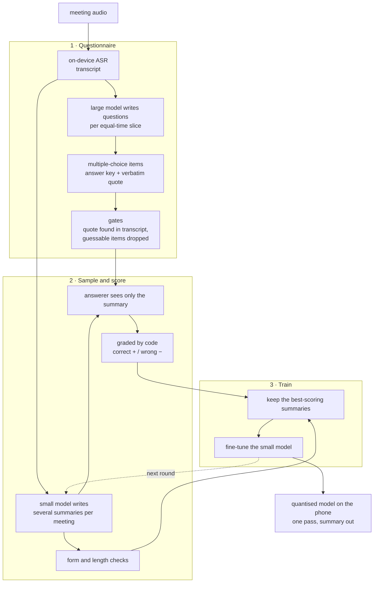

# Meeting Summarizer v4

Reliable minutes for long meetings, produced **on the phone**.

The input is a 1.5–3 h zh-TW meeting transcribed by on-device ASR. The output is a structured summary in which statements cite the transcript time they rest on.

**Status, 2026-11-13: research. The questionnaire score is validated; one offline training round ran and gave no gain. Nothing from v4 is released.**

One small model on the phone reads the whole transcript once and writes the summary directly. The student is **Bolt 4GB**, run CPU-only on a Galaxy Note10+; Gemma-4-E2B stays the model for the **Samsung Galaxy A53**. The target is 2–3 h zh-TW meetings mixed with English. Inputs longer than 64k tokens are truncated to 60k (prefill ≈ 90 min on the Note10+, 3.2 GB peak). The bar is a readable summary of fixed length (400 + 600 characters per hour, capped at 2200) that answers as many questionnaire items as the teacher's.

**Idea.** A good summary is good in form and in content.

- *Form* (sections, length, timestamps) is enforced by a grammar and checked by code.
- *Content* is measured by a questionnaire: a reader who holds only the summary should answer questions that cover the whole meeting.

**Questionnaire.** The transcript is cut into equal-time slices so the end of the meeting weighs as much as the start. Each item has four options plus "not in the summary"; wrong options are other numbers, people or outcomes from the same meeting, so a wrong binding is caught. Items answerable without any text are dropped. Grading is a letter comparison, with no grader model.

**What we learned so far.**

- *Scoring.* A fast multiple-choice judge (d3-turbo, kappa 0.91 against the large reference judge, 15–25× faster) scores the questionnaire. It cannot replace the per-sentence contradiction judge (kappa 0.26).
- *Pair labels are noisy.* With ~17 questions per meeting, the best of 8 samples wins mostly by question-draw luck: held-out gain is only +0.02–0.05. A DPO round on such pairs was null on 4 seeds.
- *Coverage is the driver.* An item is answered 63–70 % of the time when the summary cites a moment within 2 minutes of it, and 9–17 % otherwise. Bolt puts 65 % of its citations in the first third of long sessions (position bias).
- *Length alone is not a lever.* A sweep of shorter and longer budgets, with no training, moved scores by −0.05 to +0.04.
- *Teacher.* Claude Opus 5.5 (low effort) answers 0.64 of the questions vs 0.44 for the previous teacher, with fewer contradicted sentences (20 % vs 32 %). It now writes the reference summaries for the whole training pool (212 meetings). Only its sentences that the judge finds supported are reused.

**Plan.** First tune the format without training. Then repair the student's own summaries with supported teacher statements for the parts they miss; this raises the score by +0.05 to +0.08 on a 31-meeting prototype. Each repair must pass a contradiction gate. Use RL only to make the format reliable (length band, no repeats, valid end). For long meetings ([issue #1](https://github.com/vieenrose/meeting-summarizer/issues/1)), the next test cuts transcripts over ~20k tokens into at most 3 parts. Each part gets its own one-pass summary, and decisions and actions are merged by code.

## Layout

| path | contents |
|---|---|
| `eval/onepass_summary.py` | one-pass summary with the form grammar |
| `eval/qa_build.py`, `eval/qa_mcq.py` | questionnaire builder; multiple-choice conversion |
| `eval/qa_score.py`, `eval/qa_score_mcq.py` | open-answer and multiple-choice scoring |
| `eval/judge_prose_tx.py`, `eval/judge_prose.py` | contradiction judge; coverage judge |
| `scripts/qa_metric.sh`, `scripts/qa_spread.sh`, `scripts/qa_mcq.sh` | validation runs of the questionnaire score |

## Evaluation

Every round is read on three held-out sets (financial talks, legislative sessions, multi-speaker meetings) with several seeds:

- **Contradicted rate** (`eval/judge_prose_tx.py`): each sentence is checked against the transcript around its timestamp and labelled supported, contradicted or unsupported.
- **Coverage** (`eval/judge_prose.py --units`): share of reference points the summary carries.
- **Questionnaire score** (v4): correct, wrong and abstained answers, by third of the meeting and per 1000 characters.

ASR output is never corrected; long meetings are never excluded.

## Released model and earlier work

The model currently released is **mobile-v2**, a reading agent with an external journal on Gemma-4-E2B/E4B. Its model card, app integration and results are in [docs/mobile-v2.md](docs/mobile-v2.md); older versions are in [docs/version-history.md](docs/version-history.md).

The agent is reliable but slow on a phone. v4 replaces it with one pass of a smaller model and moves the effort into the training signal. Nothing from v4 is released yet.

## Status

Research, not production. Still to do: the repair-and-gate round, the multi-part test, human evaluation, and measurement on the Note10+ / A53 (speed, heat).
