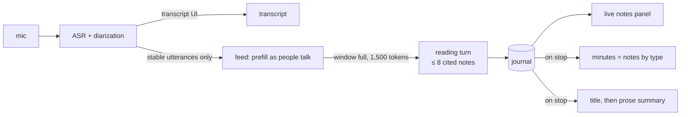

# Integrating the meeting reader into an app

This note explains how to run the **mobile-v2** meeting reader (Gemma-4-E2B or E4B) on a phone, next to ASR and diarization, and how to turn its notes into minutes, a title and a prose summary. It is written for the [VoxSumDroid](https://github.com/vieenrose/VoxSumDroid) / [Prime Minutes](https://github.com/vieenrose/PrimeMinutes) developers.

Earlier releases (mobile-v1, llama.cpp GGUFs): [integration-previous-versions.md](integration-previous-versions.md).

## 1. Choose a model

| | E4B mobile-v2 | E2B mobile-v2 |
|---|---|---|
| notes contradicted by the transcript (§9) | **8–12 %** | 14–19 % |
| peak RAM, Reno7, 4k context | 2.65 GB | **1.08 GB** |
| prefill / decode, Reno7 CPU | 43 / ~4 tok/s | **118 / ~9 tok/s** |
| time per window (prefill + decode) | ~70 s + 40–100 s | ~25 s + 15–40 s |
| choose it when | faithfulness matters most and ASR fits next to it | ASR and diarization need the memory |

Both use the same engine, protocol and prompts. Both keep up with a live meeting: a window covers 3–4 min of speech.

**Run them on the CPU, with the forked engine (§4).** Stock LiteRT-LM (§5) works with the same weights, but needs twice the memory. The GPU is not supported: on the Reno7's Mali-G68 it needs fp32 activations and is then slower than the CPU.

## 2. Files

| | E2B | E4B |
|---|---|---|
| repo | [`Luigi/gemma-4-E2B-meeting-agent-zh`](https://huggingface.co/Luigi/gemma-4-E2B-meeting-agent-zh) | [`Luigi/gemma-4-E4B-meeting-agent-zh-LiteRT`](https://huggingface.co/Luigi/gemma-4-E4B-meeting-agent-zh-LiteRT) |
| revision | `885cdffc87aaf1d8095266b506edbb8e8f07598b` | `389bc2f944f1c5a4d74bc30348e32e13e931d987` |
| engine files | `mobile-v2/mfa/` | `mobile-v2/mfa/` |
| system prompt | `mobile-v2/system_prompt.txt` | `mobile-v2/system_prompt.txt` (same file) |

Pin every file by revision, size and sha256:

| file | E2B bytes, sha256 | E4B bytes, sha256 |
|---|---|---|
| `mfa/prefill_decode_fused.tflite` | 818,394,320, `df54bbbb1f96047268fa28f182d00da48f22a4a3d649e34addc0633cfaf97d36` | 2,260,210,576, `2d346d0e5f4c1a91ae3ab9df7cea2e29992f4d60a7c661ccbc886e964fe618d0` |
| `mfa/Section2_TFLiteModel_tf_lite_embedder.tflite` | 103,811,720, `280327ee5720663acd2268c2e5d42caad33f70ba7931eef8c8b3018b4e2a4980` | 170,920,584, `94cf45ffd3d0dd7040d27b22e70845cf1054db90613bf31d8ffc1623d23d4a40` |
| `mfa/Section3_TFLiteModel_tf_lite_per_layer_embedder.tflite` | 1,284,518,392, `dca1e5553b4159558b17073c94fcc7ff16646e99a56a0614728435ac4b571720` | 836,778,512, `d35fe41db89fa0128f5da9530886a12581cee715369e1b9ed9a3644e43d16a6a` |
| `mfa/Section1_SP_Tokenizer.spiece` | 4,689,013, `e594c8a90eb08d8bda498ff4747977dc827ae0c3c56b5c0d41a605a22d02ef03` | same |
| `system_prompt.txt` | 1,686, `044150e8e18c05f807c88ca88358953f81fcc74fe85959184d66c65d81fd4843` | same |
| `gemma-4-E?B-meeting-agent-zh-mobile-v2.litertlm` (stock LiteRT-LM only, §5) | 2,588,138,320, `2c2dc0ba618d51966b2bb57f55d8ae0cc75a12759ef5552af8c4b620f48b7aed` | 3,659,518,480, `d8c3a9d4832b13a45467b4435fc4e982c2b2ce705b65cb7c75a141e936ad43db` |

Download sizes: 2.2 GB (E2B) and 3.3 GB (E4B) for the engine files. The `.litertlm` is not needed with the forked engine. The folders `lora/` and `safetensors/` hold the training checkpoints; the app does not need them.

**Licence.** Apache-2.0, like the Gemma-4 base, and compatible with VoxSumDroid's GPL-3.0. No training data ships with the model.

## 3. How the reader runs in the app



Three lanes share the CPU:
1. **ASR and diarization** keep priority: they are the only lane that cannot fall behind without losing audio.
2. **Feed.** Stable transcript lines are prefilled into the reader while people talk. This is most of the model's work.
3. **Reading turn.** When a window holds 1,500 tokens of transcript (3–4 min of speech), the model writes up to 8 notes and stops.

Rules:
- **Feed only stable utterances.** A line fed while its speaker label is still provisional stays wrong in the cache.
- **One LLM thread, at lower priority than ASR.** Serialize every engine call. Queue lines; never drop them. If the reader falls behind, it catches up during pauses, and the tail is processed right after stop.
- **At stop:** run the last partial window, assemble the minutes (§6.4), then write the title (§6.5) and the prose summary (§6.6).
- **Gate the live mode on RAM** (for example ≥ 8 GB). Below that, run the same protocol after transcription.

## 4. The forked engine (recommended)

**Code:** [vieenrose/LiteRT-LM, branch `mobile-fused-attention`](https://github.com/vieenrose/LiteRT-LM/tree/mobile-fused-attention), directory `contrib/mobile_fused_attention/`. It runs Google's mobile graph with each attention block fused into one int8 op, on the stock `libLiteRt.so` (`com.google.ai.edge.litert:litert:2.1.6`). Greedy output is token for token that of stock LiteRT-LM, at half the memory.

### 4.1 Build

NDK r26d, arm64, against the AAR's `libLiteRt.so` (full command in the fork's README):

```bash
cmake .. -DCMAKE_TOOLCHAIN_FILE=$NDK/build/cmake/android.toolchain.cmake -DANDROID_ABI=arm64-v8a \
  -DANDROID_PLATFORM=android-26 -DMFA_MARCH=armv8.2-a+dotprod \
  -DLITERT_INCLUDE=<litert/c headers> -DLITERT_LIB=<arm64 libLiteRt.so from the 2.1.6 AAR> \
  -DOpenMP_CXX_FLAGS=-fopenmp -DOpenMP_CXX_LIB_NAMES=omp \
  -DOpenMP_omp_LIBRARY=$NDK/toolchains/llvm/prebuilt/linux-x86_64/lib/clang/17/lib/linux/aarch64/libomp.a
```

- **CPU requirement:** the ARMv8.2 dot-product extension (`asimddp` in `/proc/cpuinfo`), present on most arm64 phones since 2018. Without it, use stock LiteRT-LM (§5).
- **Threads:** 8 on the Dimensity 900. The engine sets `KMP_BLOCKTIME=0` and `OMP_WAIT_POLICY=PASSIVE` itself.

### 4.2 Start it

Ship the engine as an executable and drive it over stdin/stdout:
1. Package it as `jniLibs/arm64-v8a/libmfa_engine.so`, with `packaging { jniLibs.useLegacyPackaging = true }`, so it is extracted to `applicationInfo.nativeLibraryDir`, where the app may execute it.
2. Start it with `ProcessBuilder(nativeLibraryDir + "/libmfa_engine.so", "--serve", "--dir", modelDir, "--main", modelDir + "/prefill_decode_fused.tflite", "--fused", "--ctx", "4096", "--threads", "8", "--weight-cache", filesDir + "/mfa.wcache")`, with `LD_LIBRARY_PATH` set to `nativeLibraryDir`.
3. Wait for `READY <ctx>`, then keep it resident for the whole meeting.

**Weight cache.** On the first run the engine builds the XNNPACK weight cache (0.79 GB for E2B, 2.2 GB for E4B), without exceeding its warm memory peak. Build it once after the download, before any recording. **Delete it whenever the main graph changes** (a model update): it is built from the old graph.

An in-process JNI engine (`nativeLoad` / `nativeGenerate` / `nativeCancel` / `nativeFree`, as `llm_jni.cpp` exposes for llama.cpp) is the target, but not done yet.

### 4.3 Line protocol

One request at a time:

```
→ R <max_new> <temperature> <top_k> <top_p> <seed> <n> <id_1> … <id_n>
← T <id>                       one line per generated token
← D <reason> <prefilled> <reused> <prefill_s> <decode_s>      reason: stop | length | cancel | ctx
← E <message>                  bad request (e.g. prompt longer than the context)
→ C                            cancel while tokens stream
```

- **Prefix reuse.** The engine reuses the longest prefix of the new prompt already in its cache and prefills only the rest. Send the whole prompt every time; there are no sessions to manage.
- **Feeding.** `R 0 …` prefills without generating. After each ASR segment of at least ~500 characters, send the growing prompt with `max_new = 0`. When the window closes, send the complete prompt with `max_new = 400`: only the tail is computed then.
- **Stop.** Generation stops at `<eos>` (1), `<turn|>` (106) and 50. Cancel with `C` once the decoded text holds `\nNEXT`, or at 400 tokens.
- **Sampling.** `temperature 0.2`, `top_k 40`, `top_p 0.95`, a fixed seed.

### 4.4 Tokenizer

The engine takes token ids. Load `Section1_SP_Tokenizer.spiece` with [SentencePiece](https://github.com/google/sentencepiece) (C++, builds with the NDK).
- It parses the template's special tokens by itself (`<|turn>` = 105, `<turn|>` = 106) and matches the Hugging Face Gemma-4 tokenizer exactly.
- Prepend `<bos>` (id 2) yourself.
- Decode the reply incrementally with `DecodeIds()` over the ids so far.
- Use exact token counts for the window (1,500) and journal (1,200) limits.

## 5. Stock LiteRT-LM (fallback)

For devices without `dotprod`, or before the forked engine is integrated. Same weights and protocol; peak RAM about twice the forked engine's (E4B 4.58 GB on the Reno7, so E2B only in practice).

```kotlin
val engine = Engine(EngineConfig(
    modelPath = file.absolutePath,                 // the mobile-v2 .litertlm
    backend = Backend.CPU(threadCount = 8),
    visionBackend = null, audioBackend = null,
    maxNumTokens = 4096,
    cacheDir = context.cacheDir.path))             // XNNPACK weight cache, built on the first run
engine.initialize()
val sessionConfig = SessionConfig(SamplerConfig(topK = 40, topP = 0.95, temperature = 0.2, seed = 0))

fun readWindow(k: Int, journal: String, lines: Flow<String>): String {
    engine.createSession(sessionConfig).use { s ->           // one fresh session per window
        s.runPrefill(text("<|turn>system\n$SYSTEM<turn|>\n<|turn>user\n$journal<turn|>\n" +
                          "<|turn>model\nNEXT<turn|>\n<|turn>user\n## 逐字稿片段 $k\n"))
        lines.collect { s.runPrefill(text(it)) }              // feed stable lines, >= ~500 characters each
        s.runPrefill(text("<turn|>\n<|turn>model\n"))
        return s.runDecode()                                  // notes, ending with NEXT
    }
}
private fun text(t: String) = listOf(InputData.Text(t))
```

- Runtime: `com.google.ai.edge.litertlm:litertlm-android:0.17.1`. Keep one session open at a time.
- `runPrefill` parses the template's special tokens. Do not write `<bos>`: the engine adds it.
- The Kotlin API has no tokenizer: count **1.63 characters per token** for zh-TW.
- Version 0.17.1 has no output cap in Kotlin. Decode with `generateContentStream` and call `session.cancelProcess()` once the reply holds `\nNEXT` or about 650 characters.

## 6. The protocol

The model was trained on exactly this protocol. Another prompt, template or line format silently costs quality.

### 6.1 A reading prompt

Each window is one fresh prompt, built as text and then tokenized:

```
<bos><|turn>system\n{SYSTEM}<turn|>\n
<|turn>user\n{JOURNAL}<turn|>\n<|turn>model\nNEXT<turn|>\n
<|turn>user\n## 逐字稿片段 {k}\n{lines…}<turn|>\n<|turn>model\n
```

- `{SYSTEM}`: `mobile-v2/system_prompt.txt`, verbatim.
- `{JOURNAL}`: `## 筆記本（至今）\n` and the journal compacted to **≤ 1,200 tokens** (§6.3), or `（尚無筆記）` at the start.
- `{lines}`: one line per stable utterance, `[{ts}] S{speaker+1}: {text}`. `{ts}` is `m:ss` under an hour and `h:mm:ss` from an hour on. Close the window at **1,500 tokens** of lines; split a longer line.

The whole prompt stays under ~3.7k tokens, leaving room for a 400-token reply in the 4k context.

### 6.2 Parsing the notes

Generate at most 400 tokens; stop at `\nNEXT`. Keep only the lines matching:

```
^\s*NOTE\s*\[?(\d+:\d{2}(?::\d{2})?)\]?\s*(?:\((\w[\w-]*)\)\s*)?(.+)$
```

Guards:
- keep at most 8 notes per turn (the number mobile-v2 was trained and evaluated with);
- drop a note whose time does not resolve to a transcript line;
- drop a note that repeats one of the last 30 (character-bigram Jaccard > 0.6).

Append kept notes to the journal as `#{id} [{ts}] ({TYPE}) {text}`.

| type | meaning | minutes section |
|---|---|---|
| `DECISION` | a decision announced in the meeting (通過, 決定, 定案, 同意照辦); a proposal is not one | 決議事項 |
| `ACTION` | an assigned task: someone is to do it, or a deadline is set | 待辦與負責人 |
| `PROPOSAL` | a suggestion or option still under discussion | 討論要點 |
| `OPEN-ISSUE` | held, disputed, or to be confirmed | 保留與未決 |
| `NUMBER` | a key figure | 重要數字 |

**Proposal guard** (`reclassify_proposals` in `eval/realtime_agent.py`): a `DECISION` or `ACTION` that matches `建議|提議|可考慮` (or starts with 建議, 提議, 可以, 可考慮, 考慮, 希望, 應該, 應, 或許, 是否, 討論, 研議) and contains none of 通過, 決定, 決議, 同意, 定案 is filed as `PROPOSAL`.

### 6.3 Compacting the journal

The journal outgrows the context within a meeting. Before each window, keep notes in this order until the budget is reached: `DECISION`, then `OPEN-ISSUE`, then `ACTION`, newest first within each, then the most recent other notes. Keep ids and chronological order, and add `（另有 N 則較早的筆記未列出）` for the rest. Reference: `compact_notes()` in [`eval/conversion_prompts.py`](../eval/conversion_prompts.py).

### 6.4 Minutes

The model does not write the minutes; they are assembled from the journal:

```
【決議事項】 DECISION · 【待辦與負責人】 ACTION · 【保留與未決】 OPEN-ISSUE · 【討論要點】 PROPOSAL · 【重要數字】 NUMBER
- {text} [{ts}]        (or "- 無" for an empty section)
```

Every item keeps its `[ts]`, so tap-to-play works on it directly.

### 6.5 Title

At stop, a fresh prompt (no system turn), on the journal compacted to **3,900 characters** (§6.3):

```
以下是一場會議的筆記：

{notes, one per line}

為這場會議寫一個標題，不超過 20 個字。只輸出標題。
```

Generate at most 48 tokens; it stops at `<turn|>`. Keep the first non-blank line, strip `「」"*#` and spaces, cut at 40 characters (`clean_title()`). If the title is empty or over 20 characters, fall back to the app's own title step.

### 6.6 Prose summary

After the title, a fresh prompt on the same compacted notes:

```
以下是一場會議的筆記：

{notes, one per line}

根據這些筆記，用連貫的段落寫一份會議摘要（不要條列、不要標題），說明討論了什麼、決定了什麼、誰要做什麼、還有什麼沒解決。只寫筆記裡有的內容；提到某件事時在句尾附上筆記的時間，例如 [1:23]。
```

Generate at most 600 tokens. Remove every `[ts]` that is not a time in the journal, drop bullet and header lines, join paragraphs with a blank line (`clean_prose()`). Show each `[ts]` as a tap-to-play link, and label the paragraph as a machine summary of the notes.

Keep both prompts byte for byte: reference copies are `title_prompt()` and `prose_prompt()` in [`eval/conversion_prompts.py`](../eval/conversion_prompts.py).

## 7. Memory and speed

Reno7 (Dimensity 900, 8 GB), forked engine, CPU, 8 threads, 4k context, a 2,881-token reading prompt, nothing else running:

| | E2B | E4B |
|---|---|---|
| peak RSS, warm | 1.08 GB | 2.65 GB |
| peak RSS, first run (builds the weight cache) | 1.48 GB | ≈ 2.7 GB |
| prefill | 114–130 tok/s | 43 tok/s |
| decode | ~9 tok/s | ~4 tok/s |

- **Why 4k.** XNNPACK's attention workspaces grow with the square of the context. 8k stays under 3 GB with the forked engine, but costs 10–20 % of the speed and only improves decision recall.
- **Still to measure in the app:** memory and speed with ASR and diarization resident, and heat over a full meeting.

## 8. What the UI should say

About one note in ten (E4B) to one in six (E2B) is contradicted by the transcript. The errors are mostly relational: the right figure attached to the wrong year, article or body.
- Show every note with its timestamp, tap-to-play: that is how a user checks a note in two seconds.
- Label the live panel as notes, not as authoritative minutes.
- Key figures and decisions are the most error-prone sections; consider a "verify" affordance on them.

## 9. Quality

43 held-out meetings that were never trained on: 10 Taiwanese financial TV programs, 13 Legislative Yuan committee meetings, 20 AliMeeting business meetings. Forked engine, CPU, 4k. Gemma-4-31B judges each cited note against the transcript; coverage is the share of reference points recovered from the notes.

| | financial TV | Legislative Yuan | AliMeeting |
|---|---|---|---|
| E4B: notes contradicted | 11.7 % | 9.6 % | 8.0 % |
| E4B: coverage | 0.76 | 0.97 | 0.91 |
| E2B: notes contradicted | 19.1 % | 14.5 % | 13.7 % |
| E2B: coverage | 0.74 | 0.98 | 0.88 |

The title and prose calls (§6.5, §6.6) were not re-measured for mobile-v2.

## 10. Upgrading from mobile-v1

The engine, file layout, template, protocol and budgets are unchanged; the embedders and tokenizer are byte-identical. Three things change:

1. **Main graph:** a new `prefill_decode_fused.tflite`. Delete the weight cache (§4.2).
2. **System prompt:** `每段最多 5 則` becomes `每段最多 8 則` (same size, new sha256). Pair each prompt with its own weights. Set the per-turn note cap to 8 to match the evaluation.
3. **No GPU graph:** `mobile-v1/mfa-gpu/` holds mobile-v1 weights. Do not pair it with mobile-v2: switching backend would switch models.

Against mobile-v1, E4B contradicts the transcript significantly less (−1.5 points, 95 % CI −2.9 to −0.2), and E2B's gain is within noise. Both cover financial programs better (+0.12) and AliMeeting worse (about −0.05 to −0.08), and write more notes per window.

**Prime Minutes, iOS (`ios/App/ModelStore.swift`):**

```swift
private static let promptSha = "044150e8e18c05f807c88ca88358953f81fcc74fe85959184d66c65d81fd4843"   // mobile-v2/system_prompt.txt
static let e2b: ReaderModel = {
    var m = make("E2B", "Luigi/gemma-4-E2B-meeting-agent-zh", "885cdffc87aaf1d8095266b506edbb8e8f07598b",
        dir: "mobile-v2/mfa", prompt: "mobile-v2/system_prompt.txt", [
        (103_811_720, "280327ee5720663acd2268c2e5d42caad33f70ba7931eef8c8b3018b4e2a4980"),
        (1_284_518_392, "dca1e5553b4159558b17073c94fcc7ff16646e99a56a0614728435ac4b571720"),
        (818_394_320, "df54bbbb1f96047268fa28f182d00da48f22a4a3d649e34addc0633cfaf97d36")])
    m.gpu = nil   // no mobile-v2 GPU graph
    return m
}()
static let e4b = make("E4B", "Luigi/gemma-4-E4B-meeting-agent-zh-LiteRT", "389bc2f944f1c5a4d74bc30348e32e13e931d987",
    dir: "mobile-v2/mfa", prompt: "mobile-v2/system_prompt.txt", [
    (170_920_584, "94cf45ffd3d0dd7040d27b22e70845cf1054db90613bf31d8ffc1623d23d4a40"),
    (836_778_512, "d35fe41db89fa0128f5da9530886a12581cee715369e1b9ed9a3644e43d16a6a"),
    (2_260_210_576, "2d346d0e5f4c1a91ae3ab9df7cea2e29992f4d60a7c661ccbc886e964fe618d0")])
```

The E2B repo was renamed from `Luigi/gemma-4-E2B-meeting-agent-zh-GGUF`; old URLs redirect. The new revision makes the store re-download every file once, including the unchanged embedders; keep the old files when their sha256 matches to avoid it.
